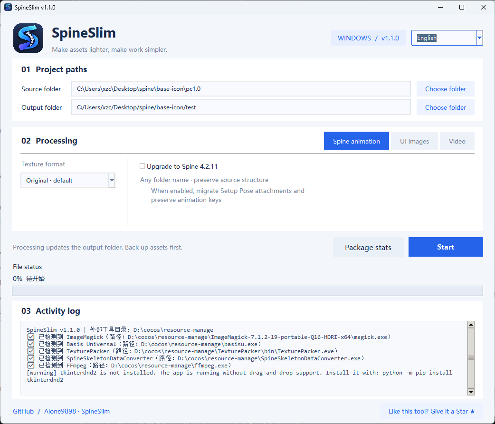

# SpineSlim

[中文说明](README.zh-CN.md) · [Releases](https://github.com/Alone9898/SpineSlim/releases) · [Report an issue](https://github.com/Alone9898/SpineSlim/issues)

SpineSlim is a Windows desktop tool for batch processing Spine assets, UI images, and videos.



If SpineSlim helps you, please [star the repository](https://github.com/Alone9898/SpineSlim). SpineSlim is an independent project and is not affiliated with Spine.

## Features

- Validate Spine JSON and upgrade data to Spine 4.2.11.
- Migrate Setup Pose attachments while preserving existing animation keys.
- Choose original format, WebP, PNG, JPG, or Basis for Spine and UI textures.
- Update Atlas references when texture formats change.
- Accept Spine folders with any name and preserve the source directory structure.
- Process UI images, atlases, bitmap fonts, BG assets, and WebM / VP9 videos.
- Chinese and English UI, folder drag-and-drop, progress, logs, and package statistics.

This document describes the current source. For a downloaded binary, also read its release notes. Windows is the primary supported platform; no macOS package is currently available. The online Spine viewer is planned for phase two; animation preview is not available yet.

## Choosing a texture format

| Option | Behavior | Suggested use |
| --- | --- | --- |
| Original (default) | Keep extensions; attempt lossless PNG compression and retain other existing formats | Preserve the existing asset integration |
| WebP | Lossy compression with adjustable quality and transparency support | Reduce size when your runtime supports WebP |
| PNG | Lossless, preserving dimensions and transparency; keep an existing PNG if compression makes it larger | Lossless assets with transparency |
| JPG | Lossy with adjustable quality; flatten transparent areas onto white | Backgrounds without transparency |
| Basis | The current converter produces `.basis`; requires runtime decoding or transcoding support | Projects with a compatible GPU texture pipeline |

The selection applies to textures handled by each workflow, rather than every file in a folder. Spine processes Atlas textures and other PNG files separately. UI background conversion handles PNG/JPG/JPEG; original mode only compresses PNG files. Spine and UI format settings are saved separately. WebP/JPG quality ranges from 0–100; higher values generally produce clearer, larger images. Compression results depend on the input.

## Output structure

```text
output/
└─ program/
   ├─ spine/          # Preserve paths inside the selected Spine source
   ├─ bg/             # UI backgrounds at their original dimensions
   ├─ atlas/          # UI atlas output
   ├─ fonts/          # TTF / OTF fonts
   ├─ part/           # JSON from a folder named part
   └─ video/
      ├─ pc/          # WebM at original dimensions
      └─ mobile/      # WebM at approximately half width and height, rounded to even sizes
```

This shows the main directories; actual output depends on the mode and assets. Spine inputs do not need to be named `mp` or `pc`. For example, `source/characters/hero.atlas` becomes `output/program/spine/characters/hero.atlas`. Videos still produce separate PC/Mobile outputs.

### UI classification

- PNG/JPG/JPEG inputs are supported. Files with `guide` in their names are skipped.
- If the third underscore-separated name segment is `pce`, the image enters atlas packing; `pack` marks it as a background.
- Without these markers, JPG/JPEG files become backgrounds. PNG files with width below 2048 and height below 1024 enter atlas packing; other sizes become backgrounds.
- Files beginning with `winnum` enter the bitmap font workflow, which uses Pillow and does not require BMFont.
- “Process all images as backgrounds” skips regular sprite atlas packing. Fonts, bitmap font assets, and videos still follow their own classification paths.

### Video options

MOV, MP4, M4V, WebM, MKV, and AVI inputs are converted to WebM / VP9. Audio, when present, is encoded as Opus. CRF ranges from 0–63; higher values generally produce smaller files. Start with 32–40. Alpha preservation requires a source with alpha and a playback environment that supports VP9 Alpha.

## Run locally

Download the Windows x64 archive from [Releases](https://github.com/Alone9898/SpineSlim/releases/latest), extract it, and launch the EXE. Python is not required. The app searches common tool locations and offers automatic search, manual path selection, or official download pages when a tool is missing.

For source runs, use Windows and Python 3.12+:

```powershell
git clone https://github.com/Alone9898/SpineSlim.git
cd SpineSlim
python -m venv .venv
.\.venv\Scripts\python.exe -m pip install -r requirements.txt
.\.venv\Scripts\python.exe .\main.py
```

## External tools

Third-party tools are not bundled. Obtain them from their official publishers:

| Tool | Purpose |
| --- | --- |
| [ImageMagick](https://imagemagick.org/) | Image compression and conversion |
| [Basis Universal](https://github.com/BinomialLLC/basis_universal) | Basis / KTX2 compression |
| [TexturePacker](https://www.codeandweb.com/texturepacker) | UI atlases |
| SpineSkeletonDataConverter | Spine version conversion |
| [FFmpeg](https://ffmpeg.org/) | Video conversion |

The Spine converter is used when upgrading is enabled. Image conversion uses ImageMagick or Basis Universal, UI atlas packing uses TexturePacker, and video conversion uses FFmpeg. The current UI startup check requires both ImageMagick and TexturePacker, including when all images are treated as backgrounds. UI inputs containing videos also require FFmpeg.

Discovery checks saved paths, the application folder, system PATH, and common TexturePacker installation locations. Manual selections are saved in `config.json`. Keep companion files with portable tools. SpineSkeletonDataConverter is a separate third-party converter, not the Spine editor; verify its origin and license before use.

## Workflow

1. Select 中文 / Chinese or English from the top-right menu.
2. Choose source, output, and resource type: Spine, UI images, or video.
3. Select a texture format. “Original” keeps the input extension by default.
4. Review the options and click Start.

Processing clears the relevant output folders, so use asset copies and a separate empty output folder for the first run. Spine output is written to `target/program/spine` with the source structure preserved. UI BG assets are written directly to `target/program/bg` without `mobile` or `pc` subfolders.

- Spine mode clears the entire `program/spine` tree, including legacy `mobile` / `pc` folders. The source must be outside that output tree.
- UI mode clears everything under `program` except `spine`, affecting previous UI, font, and video output.
- Video mode removes existing WebM files from `program/video/pc` and `program/video/mobile`.
- Spine 4.2 upgrading is optional, and not every input version is supported. Check preflight and conversion logs, then verify animation results in your target runtime.

JSON preflight currently accepts the 3.5, 3.6, 3.7, 3.8, 4.0, and 4.1 series for upgrading and recognizes the 4.2 series as already 4.2. Other versions are marked unsupported. An accepted version does not guarantee conversion success; JSON contents and the external converter still matter. Binary `.skel` version upgrading is not provided.

## Troubleshooting

| Problem | What to check |
| --- | --- |
| `Atlas PNG page missing` | Confirm that the referenced texture exists and its relative path is correct; select the complete folder containing skeleton data, Atlas, and textures |
| Compatibility summary says `failed=0`, but the job fails | The summary covers only version compatibility; inspect subsequent texture, Atlas, or video errors |
| External tool not found | Search automatically or select its executable manually, keeping required companion files |
| Drag-and-drop unavailable | Install `tkinterdnd2` for source runs, or use Choose folder |
| Little size reduction | Assets may already be compressed; lossless PNG does not guarantee a large reduction. Try WebP if your runtime supports it |
| White background after JPG conversion | JPG has no alpha channel. Use PNG, WebP, or original format for transparency |

When reporting a problem, include the app version, Windows version, resource mode, format settings, and relevant error logs. Share a minimal sample only if you have permission to publish it.

## Roadmap

### Phase one: Windows batch processing

The current focus is Spine/UI/video processing, format selection, tool discovery, Chinese/English UI, and output workflow improvements. Source code and a Windows build workflow are available; see Releases for the contents of each published version.

### Phase two: Online Spine viewer (planned)

A browser-based Spine animation viewer is planned to help inspect assets before and after conversion or compression. Proposed capabilities include:

- Load skeleton data, Atlas files, and textures, prioritizing local file selection or drag-and-drop.
- Switch animations and skins, with playback, pause, looping, and speed controls.
- Zoom and pan the canvas; choose a background color or checkerboard.
- Display resource information and loading errors to help diagnose texture references.
- Explore original-versus-processed previews and integration with the desktop tool.

These features are planned, not implemented, and have no committed release date. Supported Spine versions, JSON/binary formats, and texture decoding will be announced after runtime selection and validation. A viewer URL will be added when available.

## Tests and packaging

```powershell
.\.venv\Scripts\python.exe -m unittest discover -s tests -v
python -m pip install pyinstaller
python -m PyInstaller --noconfirm --clean --distpath dist --workpath build SpineSlim.spec
```

## License

The project code is licensed under the [MIT License](LICENSE), allowing modification, redistribution, and commercial use with the required license notice. Third-party tools, components, and user assets remain under their respective licenses; see [THIRD_PARTY.md](THIRD_PARTY.md).
