# SpineSlim · Spine Viewer, Texture Atlas Packer & Game Asset Toolkit

**A Windows desktop toolkit for Unity, Cocos Creator, Godot, PixiJS and Phaser game developers, with Spine and Rive preview, 3D model inspection, atlas packing and asset processing.**

SpineSlim helps indie developers, 2D game artists and technical artists preview Spine JSON/SKEL animations, create sprite sheets and texture atlases, optimize textures, and process game audio locally. HTML5 and web game developers can also export audio sprites for Howler.js and Phaser. Engine-specific formats and compatibility limits are listed below.

[Official Website](https://www.jyhzai.com/en/spineslim/) · [中文官网](https://www.jyhzai.com/spineslim/) · [Project Home](README.md) · [中文](README.zh-CN.md) · [Download / Releases](https://github.com/Alone9898/SpineSlim/releases) · [Telegram group](https://t.me/+XlcsJcxyKZtlNGYy) · [Star ⭐](https://github.com/Alone9898/SpineSlim)

This guide covers the Tauri 2.0 development line, with source version `2.0.0-alpha.8`. Visit the [SpineSlim official website](https://www.jyhzai.com/en/spineslim/) for the product overview and check the release notes for your downloaded build. Older 1.x packages do not include all new modules. Windows x64 is the primary platform; no macOS installer is available yet.

## Quick start

1. Visit the [official website](https://www.jyhzai.com/en/spineslim/) for the product overview, or choose a Windows x64 build from [Releases](https://github.com/Alone9898/SpineSlim/releases). Development builds may be marked Pre-release.
2. Run the installer or fully extract the portable archive, depending on the attachments provided. Packaged builds do not require Python, Node.js or Rust.
3. Choose **Spine viewer / Rive viewer / 3D model viewer / Atlas packer / Asset processing / Audio processing** and import local files or folders.
4. Install the external tools required for your workflow. Asset processing source and output folders must not overlap.

Chinese is the default language; select English or check for software updates in Settings. The app runs in its own desktop window and processes assets locally. Windows needs WebView2; check the release notes for offline runtime availability.

The Rive viewer opens local `.riv` files offline, switches artboards and state machines, and tests legacy inputs. The 3D model viewer inspects local models, materials and animations. Both support file or folder drag and drop. See the [Rive viewer guide](docs/RIVE_VIEWER.md) and [3D model viewer guide](docs/MODEL_VIEWER.md).

## AI Asset Audit: local checks and optional model chat

Choose or drop an asset directory to run local checks for exact duplicates, missing dependencies, image dimensions and padding, large files, naming and format issues. Filter and search findings, locate affected files, inspect rule coverage, and export JSON or HTML reports. The audit does not change original files; uncovered assets are not treated as verified.

After scanning, optionally choose your own DeepSeek, OpenAI-compatible, Anthropic or Gemini model and ask about the audit. The default summary contains counts and issue types only. Relative file names and evidence are included only when explicitly selected. A network request is made only when you press Send; provider charges may apply. AI suggestions require review, and SpineSlim does not automatically delete assets.

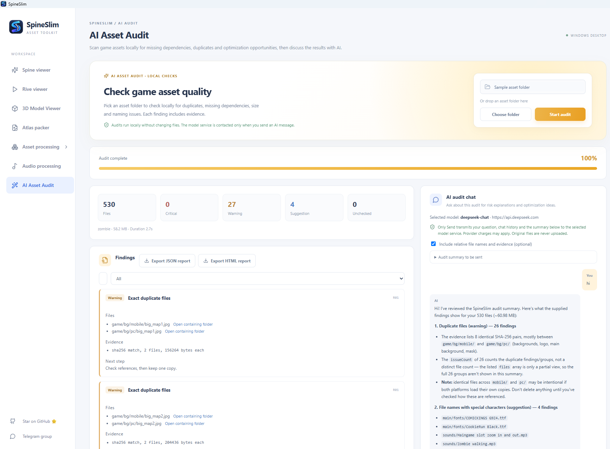

## Spine animation viewer for JSON and SKEL files

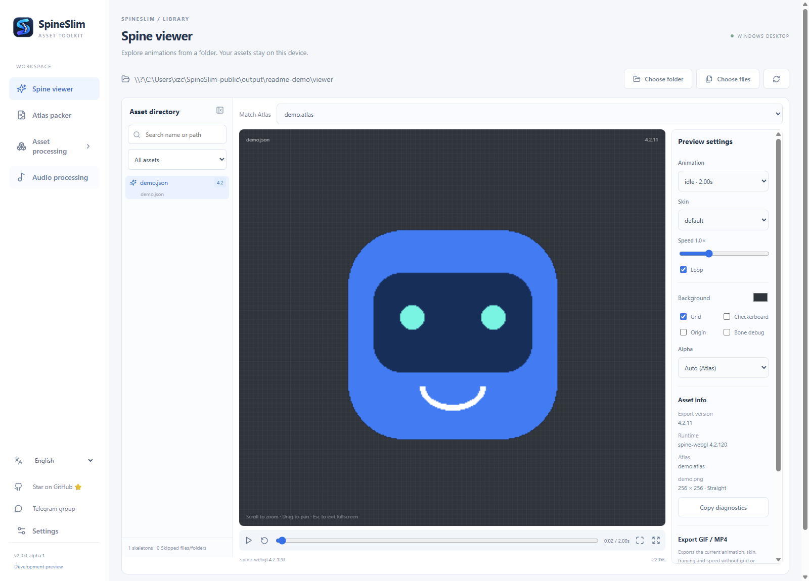

- Scan directories, browse/search skeletons, and match Atlas files and textures.
- Load Spine **3.8 / 4.0 / 4.1 / 4.2** JSON and SKEL files with PNG / JPG / WebP textures.
- Switch animations and skins; play, pause, loop, adjust speed and seek on the timeline. Copy the selected animation name repeatedly for use in game code.
- Zoom, pan, fit, fullscreen, grid, origin, checkerboard, background color and bone debug.
- Inspect export/runtime versions and texture information; select Alpha modes and copy diagnostics.
- Export the current animation, skin, framing and speed as **GIF / MP4** using FFmpeg. Exports are limited to 30 seconds; GIF supports optional transparency, MP4 uses the background color. Grid/debug overlays are excluded.

Preview does not need the Spine editor or modify source skeletons. **Preview support differs from JSON upgrade support.** Spine 3.5–3.7, 4.3 and Basis/KTX textures are not supported by the viewer. Test unusual assets in your project.

## Rive animation and state machine viewer

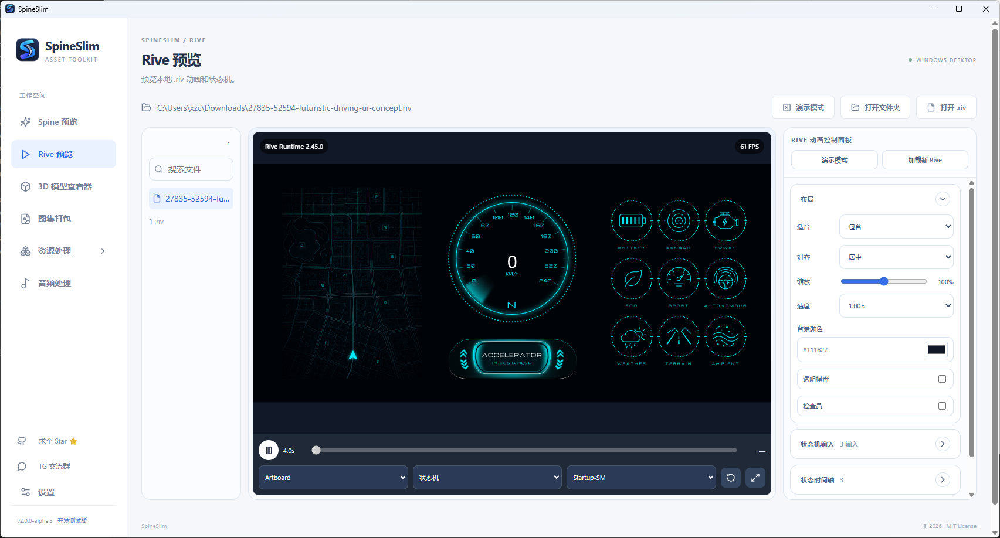

Open a local `.riv` file or scan a folder, switch artboards, animations and state machines, and test click or hold interactions. Adjust playback and layout, inspect traditional inputs, state timelines and event logs, and export a session JSON. The runtime is bundled; external assets are not downloaded automatically. [Features and limits](docs/RIVE_VIEWER.md)

## 3D model viewer

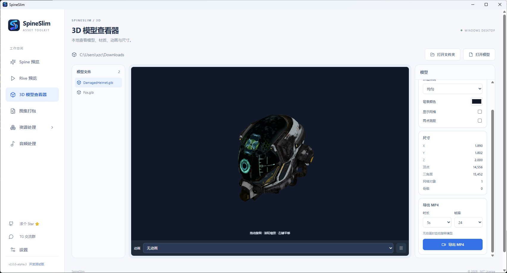

Open a GLB, GLTF, FBX, OBJ / MTL or STL file or folder. Inspect materials, animations, dimensions and meshes; switch lighting, wireframe and normals; measure between two surface points. MP4 export uses FFmpeg. Keep external GLTF buffers, OBJ materials and textures within the selected folder. Measurements use model units, which may not be metres. [Features and format limits](docs/MODEL_VIEWER.md)

## Sprite sheet and texture atlas packer for game engines

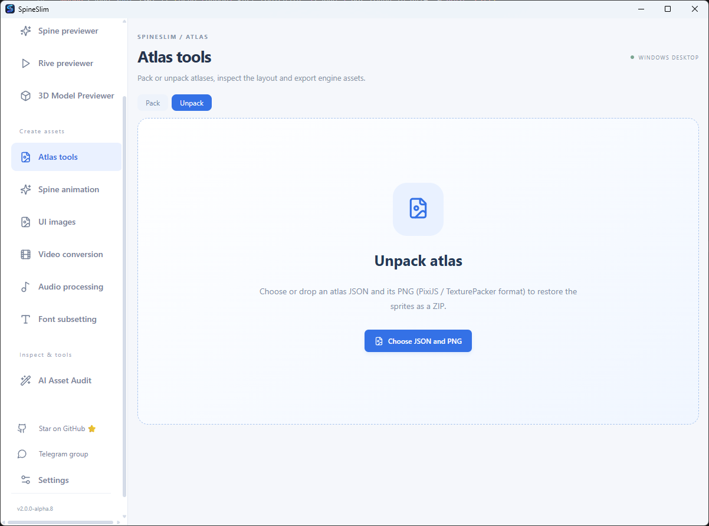

The standalone packer runs locally and **does not require TexturePacker**. Import PNG / JPG / WebP files or directories, append/search/remove images, inspect the layout and switch pages. Adjust dimensions, power-of-two/fixed sizing, scale, alpha trimming and threshold, padding and edge extrusion; packing updates automatically.

| Target | Export |
| --- | --- |
| PixiJS | PNG + spritesheet JSON with multipack references |
| Spine | PNG + a multipage Atlas |
| Cocos Creator / cocos2d-x | PNG + plist format 3 |
| Godot 4 | PNG + AtlasTexture `.tres` resources |
| Unity | PNG + `.spineslim.json` + an Editor importer |
| Phaser 3 | PNG + multiatlas JSON |

Save a ZIP, optionally including both PixiJS JSON and Spine Atlas. Unity mode keeps full canvases and disables trimming. Install the importer once under `Assets/Editor`, then use `Tools → SpineSlim → Import Atlas` to create Multiple Sprites. It does not generate a Unity `.spriteatlas` asset.

Rotation and duplicate-image merging are not implemented. Limits: 500 images, 32 Mi source pixels, 32 MiB per file, 16 output pages / 64 Mi output pixels, maximum dimension 8192. New formats have structure and coordinate tests; actual Unity / Godot / Cocos editor imports still need validation in your target project.

[Export formats and import instructions](docs/ATLAS_PACKER.md)

## Game asset processing and texture optimization

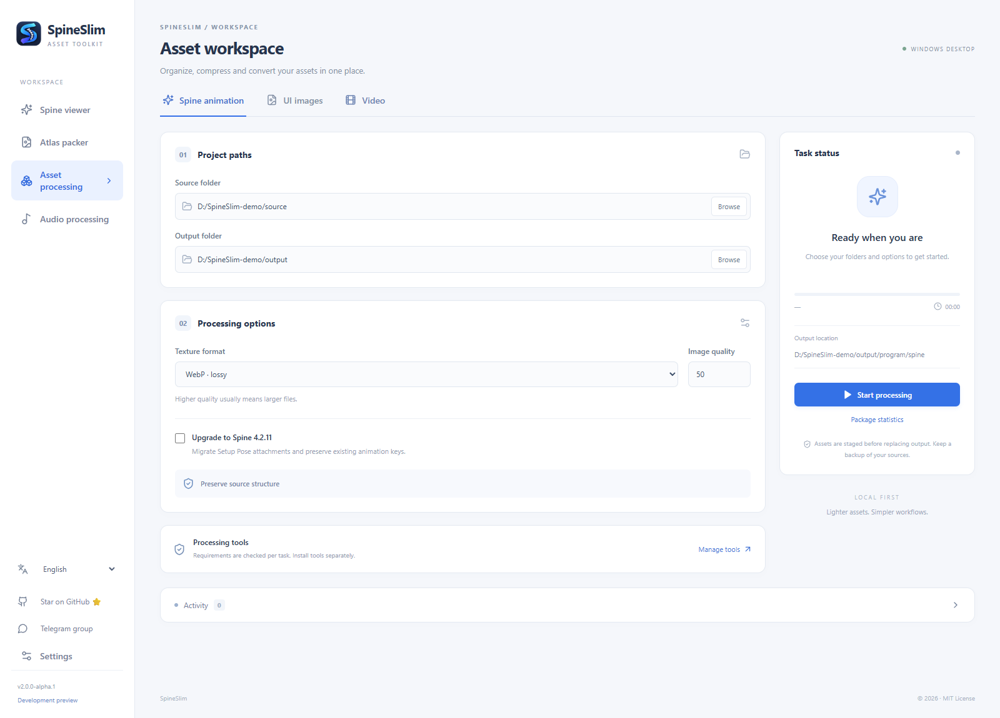

### Before and after: see the size reduction at a glance

**Background image example: JPG 2,249 KB → WebP 165 KB — about 92.7% smaller, saving approximately 2,084 KB.** The screenshot compares the original `base_bg.jpg` with the output `base_bg.webp`:

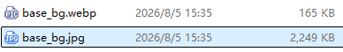

In these user-provided screenshots, a PNG texture drops from **359 KB** to **74 KB** as WebP: about **79% smaller**, saving roughly **285 KB**. SpineSlim updates the Atlas texture reference; the `.skel` needs no conversion. This workflow helps optimize texture file sizes for Unity, Cocos, Godot, PixiJS and Phaser projects. Figures describe one texture and are calculated from the rounded sizes shown in Windows Explorer; compression ratios and visual quality vary with image content, quality settings and alpha data.

| Before: PNG | After: WebP |
| --- | --- |
| 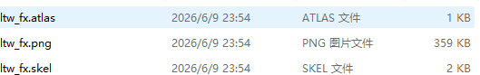 | 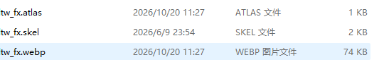 |

### Spine and textures

Recursively process Spine folders, preserve relative paths and update Atlas texture references. Spine and UI texture settings are saved independently.

| Format | Behavior |
| --- | --- |
| Original (default) | Preserve extensions; attempt lossless compression for PNGs handled by the workflow |
| WebP | Adjustable quality and transparency |
| PNG | Lossless; keep an existing PNG if compression makes it larger |
| JPG | Adjustable quality; flatten transparency onto white |
| Basis | Export `.basis`; requires support in your game runtime |

Optionally upgrade JSON to **Spine 4.2.11**, migrate setup-pose attachments and preserve existing animation keys. Preflight accepts 3.5 / 3.6 / 3.7 / 3.8 / 4.0 / 4.1 and recognizes 4.2 as already upgraded. An accepted version does not guarantee conversion of every asset. The upgrade uses an external converter and does not upgrade binary `.skel` files.

Version conversion now defaults to the **4.2.11 upgrade**. Choose “Target version (advanced)” to enter a complete `x.y.z` version in the supported 3.5–3.8 or 4.0–4.2 range, and keep the source skeleton format or output JSON / SKEL. This mode handles both Spine JSON and SKEL and writes to a separate `program/spine-converted` folder; the source remains unchanged. Atlas files and textures follow the selected asset-processing options. Downgrades may alter newer curves, constraints and timelines, so verify in the target Spine runtime. A later run replaces existing `program/spine-converted` contents.

### UI images, fonts and video

- Classify UI assets into backgrounds, atlases and fonts, or enable “Process all images as backgrounds.”
- The UI atlas pipeline uses TexturePacker, unlike the standalone Atlas packer. Background-only mode does not require TexturePacker.
- Skip image filenames containing `guide`. A third underscore-separated segment of `pce` selects atlas packing; `pack` selects a background. Otherwise JPG/JPEG becomes a background, PNG smaller than 2048 × 1024 on both axes becomes a sprite, and larger PNG becomes a background.
- `winnum` assets use Pillow-based bitmap font generation, without BMFont. The pipeline also handles TTF / OTF files and JSON under `part`.
- Convert MOV / MP4 / M4V / WebM / MKV / AVI to WebM / VP9, with Opus audio when present. CRF ranges from 0–63; higher generally means smaller. Alpha requires a source and playback environment that support it.

### Output and tasks

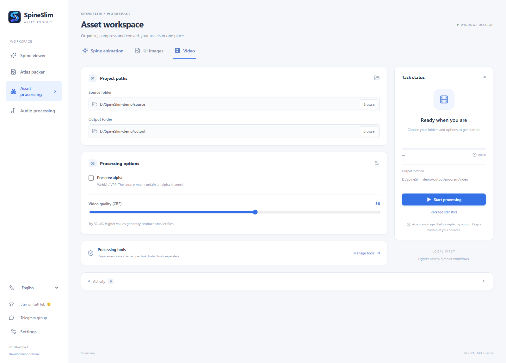

```text
output/program/
├─ spine/           Original Spine folder hierarchy
├─ bg/              UI backgrounds at original dimensions
├─ atlas/           UI atlases
├─ fonts/           Fonts
├─ part/            Classified JSON
└─ video/
   ├─ pc/           Original-size WebM
   └─ mobile/       Approximately half size, rounded to even dimensions
```

Current-file and stage progress, logs, size statistics and cancellation are available. Processing uses staging before committing results. **A successful commit replaces existing output in its scope:** Spine replaces `program/spine`; UI replaces everything under `program` except `spine`; video updates PC/Mobile WebM outputs. Use a dedicated output folder and review the confirmation dialog.

## Game audio processing: compression, merging and audio sprites

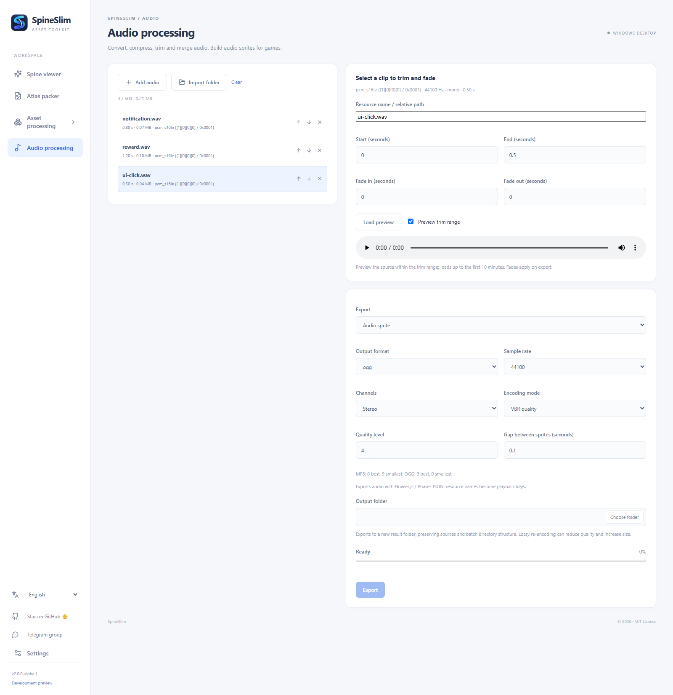

- Import files/folders or drag and drop MP3, OGG, WAV, FLAC, M4A, AAC, OPUS, AIFF and WMA.
- Inspect duration, codec, sample rate, channels and size; preview source audio within an optional trim range.
- Set start/end times and fade-in/out per clip. Reorder with arrow buttons or drag and drop.
- Batch convert/compress to **MP3, OGG Vorbis or PCM 16-bit WAV**, with sample rate, mono/stereo, VBR quality or target bitrate settings.
- **Merge short clips** in order, even with mixed formats or sample rates: normalize to PCM, concatenate, then encode.
- **Audio sprites:** export a merged audio file with Howler.js / Phaser JSON, configurable gaps and named playback segments.
- Track progress and input/output sizes, cancel work and open the result folder.

Each export creates a unique `SpineSlim-audio-*` folder and preserves sources. Batch mode preserves imported directory structure. Limits: 500 clips, two hours per source and total processing duration. Preview loads the first ten minutes; fades apply at export. All exports re-encode. Lossy processing may reduce quality and does not guarantee smaller files.

MP3 VBR: 0 is best quality, 9 smallest; OGG VBR: 9 best quality, 0 smallest. For strict timing or gapless playback, use WAV and validate in your game runtime.

[Audio workflow and game integration](docs/AUDIO_PROCESSING.md)

## External tools

| Feature | Dependency |
| --- | --- |
| Spine / Rive / 3D preview and standalone atlas packing | No external asset-processing executable; GIF / MP4 export additionally requires FFmpeg |
| GIF / MP4, audio processing and video conversion | [FFmpeg](https://ffmpeg.org/download.html); audio needs libmp3lame/libvorbis, MP4 needs libx264 |
| Standard image optimization/conversion | [ImageMagick](https://imagemagick.org/script/download.php) |
| Basis textures | [Basis Universal](https://github.com/BinomialLLC/basis_universal/releases) |
| UI atlases within Asset processing | [TexturePacker](https://www.codeandweb.com/texturepacker/download) |
| Spine JSON upgrades | SpineSkeletonDataConverter |

Discovery uses saved paths, application and `tools/<tool-key>/` folders, PATH and other supported locations. Open Settings at the bottom of the sidebar in both development and packaged builds to detect tools or choose their paths. Keep portable tools' companion files.

The default Tauri package does not bundle these external tools. The full-package script is for local testing and does not establish redistribution rights. Check each release's contents and [third-party notices](THIRD_PARTY.md).

## Develop and build

Install Windows x64, Node.js 20.19+ or 22.12+, Python 3.12+, stable Rust, MSVC C++ build tools and WebView2.

```powershell
git clone https://github.com/Alone9898/SpineSlim.git
cd SpineSlim
python -m venv .venv
.\.venv\Scripts\python.exe -m pip install -r requirements.txt pyinstaller
npm ci
.\.venv\Scripts\python.exe scripts/build_worker.py
npm run desktop
```

Rebuild the worker after editing Python code. `npm run dev` alone starts the web development server, without full desktop capabilities. The Tauri app no longer starts through the legacy `python main.py` entry point.

```powershell
npm run build
cargo check --manifest-path src-tauri/Cargo.toml
.\.venv\Scripts\python.exe -m unittest discover -s tests -v

.\.venv\Scripts\python.exe scripts/build_worker.py
npm run package
```

The default NSIS installer is generated under `src-tauri/target/release/bundle/nsis/`. The main EXE alone is insufficient: the Python worker and other packaged files are required. Validate installation, tool discovery and core workflows on a clean computer before releasing.

## FAQ

### How can I preview Spine SKEL animations on Windows?

Import the complete folder containing SKEL, Atlas and texture files into SpineSlim's Spine viewer. It loads Spine 3.8 / 4.0 / 4.1 / 4.2 and provides animation and skin controls without requiring the Spine editor. Previewing does not upgrade or rewrite source files.

### Can I pack sprite sheets without TexturePacker?

Yes. SpineSlim's standalone Atlas packer packs PNG/JPG/WebP images locally without TexturePacker. Choose PixiJS spritesheet JSON, Phaser 3 multiatlas JSON, Cocos plist, Godot 4 AtlasTexture, Unity's included Editor importer, or Spine Atlas. The separate UI classification workflow in Asset processing still uses TexturePacker.

### How do I combine short sound effects for an HTML5 game?

Use Audio sprite mode to merge clips and export timing metadata for Howler.js or Phaser, then play clips by name. Use Merge mode for continuous sequential playback, or Batch mode to keep separate files for Unity, Godot, Cocos and other workflows.

| Question | Answer |
| --- | --- |
| `Atlas PNG page missing` | A referenced texture is missing or has the wrong relative path; import the complete asset folder |
| Compatibility summary passes, task fails | The summary only covers upgrades; inspect subsequent texture/video errors |
| Does atlas packing require TexturePacker? | The standalone module does not; the UI classification atlas pipeline does |
| FFmpeg or another tool is missing | Install the complete tool on PATH and restart, or set its path in development Settings |
| How do I play clips separately after merging? | Export an audio sprite and use the Howler.js / Phaser timing metadata |
| New modules missing after download? | Check whether you downloaded legacy 1.x; 2.0 builds may be under Pre-release |
| Where is Settings? | Hidden in packaged builds by the current product configuration |
| Why white JPG backgrounds / little PNG savings? | JPG has no transparency; already optimized PNGs may not shrink |

## Community and license

Visit the [SpineSlim official website](https://www.jyhzai.com/en/spineslim/) for product information. Report issues through [GitHub Issues](https://github.com/Alone9898/SpineSlim/issues) or [Telegram](https://t.me/+XlcsJcxyKZtlNGYy). Include the app/Windows version, module, options, logs and a minimal sample you can share. If useful, please [star SpineSlim ⭐](https://github.com/Alone9898/SpineSlim).

Original project code uses the [MIT License](LICENSE). Spine runtimes, external tools and assets retain their own terms; see [THIRD_PARTY.md](THIRD_PARTY.md). SpineSlim is independent and not affiliated with Spine. Screenshots use self-created examples in the development app; packaged builds hide Settings.
