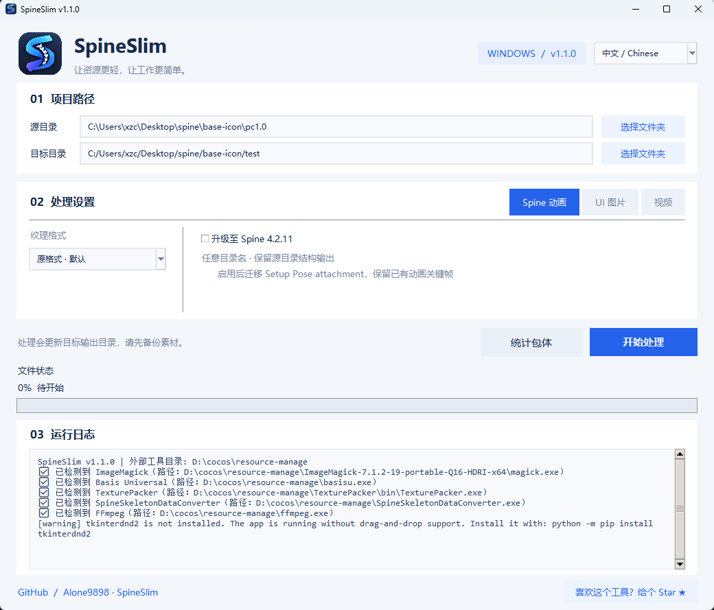

# SpineSlim

[下载最新版本 / Download latest release](https://github.com/Alone9898/SpineSlim/releases/latest) · [所有版本 / All releases](https://github.com/Alone9898/SpineSlim/releases)

Spine 资源优化与批量处理工具，支持 Spine 版本转换、纹理压缩、UI 图集和视频处理。

Spine asset optimization and batch processing for Windows.

- [中文说明](README.zh-CN.md)
- [English documentation](README.en-US.md)

## 当前功能 / Current features

Spine 版本升级与纹理压缩、保留目录结构、UI 图集与艺术字、WebM 视频、中英文界面。

Spine upgrades and texture compression, preserved folder structure, UI atlases and bitmap fonts, WebM video, and Chinese/English UI.

## 二期规划 / Phase two

计划加入 **Spine 在线查看器**：资源加载、动画与皮肤切换、播放控制和处理前后预览对比。尚未实现，支持范围与上线时间待确定。

An **online Spine viewer** is planned, including asset loading, animation and skin selection, playback controls, and before/after previews. It is not available yet; support details and release timing are to be determined.

[GitHub](https://github.com/Alone9898/SpineSlim) · [MIT License](LICENSE)
