# SpineSlim: Free Spine Viewer, Sprite Sheet Packer & Game Asset Toolkit for Windows

**English** | [简体中文](README.zh-CN.md)

**SpineSlim is a free, local Windows desktop toolkit for Unity, Cocos Creator, Godot, PixiJS and Phaser developers. Preview Spine JSON / SKEL and Rive animations, inspect 3D models, pack sprite sheets and texture atlases, compress textures, subset fonts, build Howler.js / Phaser audio sprites, and audit game assets, all offline on your own machine.**

[Official Website](https://www.jyhzai.com/en/spineslim/) · [中文官网](https://www.jyhzai.com/spineslim/) · [Download / Releases](https://github.com/Alone9898/SpineSlim/releases) · [简体中文](README.zh-CN.md) · [Telegram group](https://t.me/+XlcsJcxyKZtlNGYy) · [Report an issue](https://github.com/Alone9898/SpineSlim/issues)

If SpineSlim saves you time, please give it a **[Star ⭐](https://github.com/Alone9898/SpineSlim)**.

## What is SpineSlim?

SpineSlim is an open-source (MIT) desktop application for indie game developers, 2D game artists, technical artists and HTML5 / web game teams. It replaces a pile of separate tools with one app: a Spine animation viewer, a Rive viewer, a 3D model viewer, a sprite sheet / texture atlas packer, a texture and Spine asset optimizer, a font subsetter, an audio processor and a local asset auditor. Files are processed locally; nothing is uploaded unless you explicitly send an AI audit summary.

Built with Tauri 2, React, TypeScript and a Python worker. Chinese is the default UI language; English is available in Settings.

**Quick facts**

| | |
| --- | --- |
| Platform | Windows x64 (no macOS or Linux installer yet) |
| Current source version | `2.0.0-alpha.10` (2.0 development line; 1.x builds lack the newer modules) |
| License | [MIT](LICENSE) for project code; third-party components keep their own terms |
| Spine versions previewed | 3.8 / 4.0 / 4.1 / 4.2 (JSON and SKEL) |
| Atlas export targets | Unity, Cocos Creator / cocos2d-x, Godot 4, PixiJS, Phaser 3, Spine |
| Needs the Spine editor? | No |
| Needs TexturePacker? | No, for the standalone atlas packer |

## Features at a glance

| Module | What it does |
| --- | --- |
| **Spine viewer** | Scan local folders; Spine 3.8 / 4.0 / 4.1 / 4.2 JSON and SKEL; switch animations and skins; zoom, pan, fullscreen; export GIF / MP4 |
| **Rive viewer** | Open local `.riv` files or folders; switch artboards, animations and state machines; test inputs and read event logs |
| **3D model viewer** | GLB / GLTF / FBX / OBJ / STL; render modes, animations, two-point measurement, MP4 export |
| **Atlas tools** | Sprite sheet / texture atlas packing with alpha trimming, edge extrusion and multipage preview; export for Cocos, Unity, Godot, PixiJS, Phaser and Spine |
| **Asset processing** | Spine JSON / SKEL version conversion, texture compression (WebP / PNG / JPG / Basis), UI image classification, bitmap fonts, WebM / VP9 video conversion |
| **Font subsetting** | Trim TTF / OTF to the characters you use, WOFF output, glyph browser, metadata editing |
| **Audio processing** | Batch convert and compress, trim, fade, merge short clips, Howler.js / Phaser audio sprites |
| **AI Asset Audit** | Local scan for duplicates, missing dependencies, oversized images, naming and format issues; JSON / HTML reports; optional model chat |

## How do I use SpineSlim with Unity, Cocos Creator, Godot, PixiJS and Phaser?

| Engine / framework | What SpineSlim exports |
| --- | --- |
| **Unity 2D** | PNG + slice manifest (`.spineslim.json`) + Editor importer script, imported as Multiple Sprites. This is **not** a native `.spriteatlas` |
| **Cocos Creator / cocos2d-x** | PNG + plist (format 3) sprite sheet, including trim offsets |
| **Godot 4** | PNG + AtlasTexture `.tres` resources for Sprite2D / TextureRect / SpriteFrames |
| **PixiJS** | PNG + spritesheet JSON with multipack references |
| **Phaser 3** | PNG + multiatlas JSON; the audio module also exports audio sprite JSON |
| **Spine / Howler.js** | Spine Atlas (multipage) and Howler.js sound timing configuration |

Unity, Godot and Cocos exports have been verified for file structure and coordinates; always test the final editor import in your own project. Image atlases and audio atlases are separate outputs.

## Quick start

1. Download a Windows x64 build from [GitHub Releases](https://github.com/Alone9898/SpineSlim/releases) (2.0 builds may be marked Pre-release), or see the [official website](https://www.jyhzai.com/en/spineslim/).
2. Run the installer, or fully extract the portable archive. Packaged builds do not require Python, Node.js or Rust.
3. Pick a module in the sidebar and import local files or folders, with buttons or drag and drop.
4. Install the external tools your workflow needs (see [External tools](#external-tools)). Asset processing source and output folders must not overlap.

Windows needs WebView2; check each release's notes for whether an offline runtime is included. Settings are at the bottom of the sidebar in development builds; packaged builds may hide them by product configuration.

## AI Asset Audit: local checks and optional model chat

Choose or drop an asset directory to run local checks for exact duplicates, missing dependencies, image dimensions and padding, large files, naming and format issues. Filter and search findings, locate affected files, inspect rule coverage, and export JSON or HTML reports. The audit never changes original files, and assets not covered by a rule are not treated as verified.

After scanning, you may optionally connect your own DeepSeek, OpenAI-compatible, Anthropic or Gemini model and ask about the results. The default summary contains counts and issue types only; relative file names and evidence are included only when you explicitly select them. A network request is made only when you press Send, and provider charges may apply. AI suggestions need review, and SpineSlim never deletes assets automatically. [Design and scope →](docs/SpineSlim_AI智能体检_功能设计文档.md)

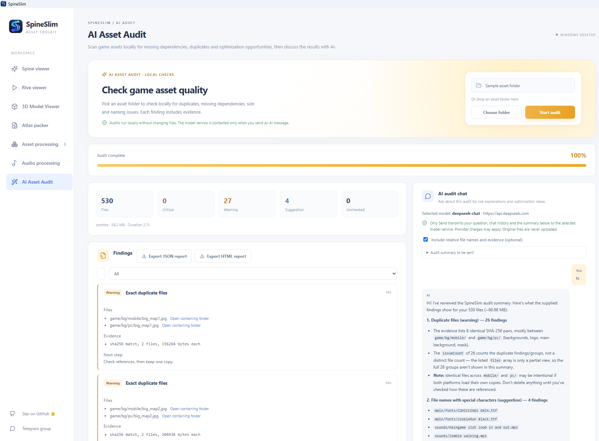

## Spine viewer for JSON and SKEL files

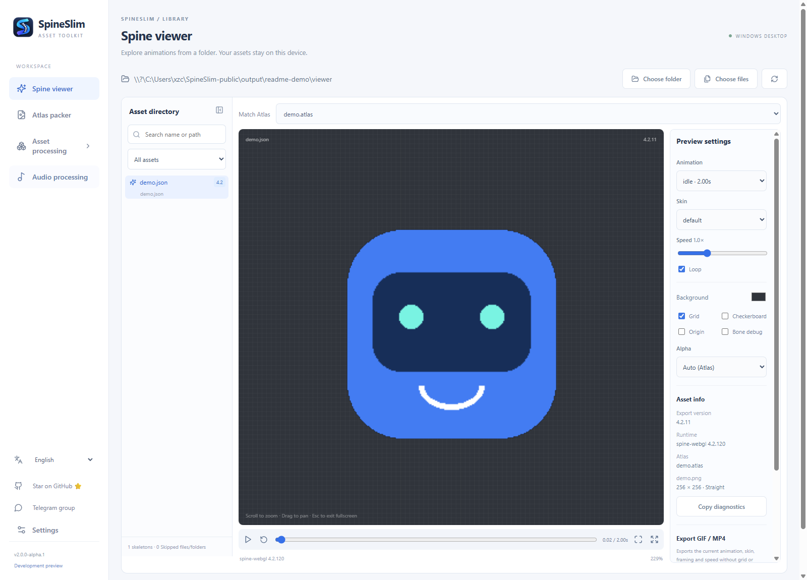

- Scan directories, browse and search skeletons, and match Atlas files and textures.
- Load Spine **3.8 / 4.0 / 4.1 / 4.2** JSON and SKEL files with PNG / JPG / WebP textures.
- Switch animations and skins; play, pause, loop, adjust speed and seek on the timeline. Copy the selected animation name repeatedly for use in game code.
- Zoom, pan, fit, fullscreen, grid, origin, checkerboard, background color and bone debug.
- Inspect export / runtime versions and texture information; select Alpha modes and copy diagnostics.
- Export the current animation, skin, framing and speed as **GIF / MP4** using FFmpeg. Exports are limited to 30 seconds; GIF supports optional transparency, MP4 uses the background color. Grid and debug overlays are excluded.

Preview does not need the Spine editor and never modifies source skeletons. **Preview support differs from JSON upgrade support.** Spine 3.5–3.7, 4.3 and Basis / KTX textures are not supported by the viewer. Test unusual assets in your project. Spine Runtime use and redistribution are governed by its own license.

## Rive viewer: animations and state machines

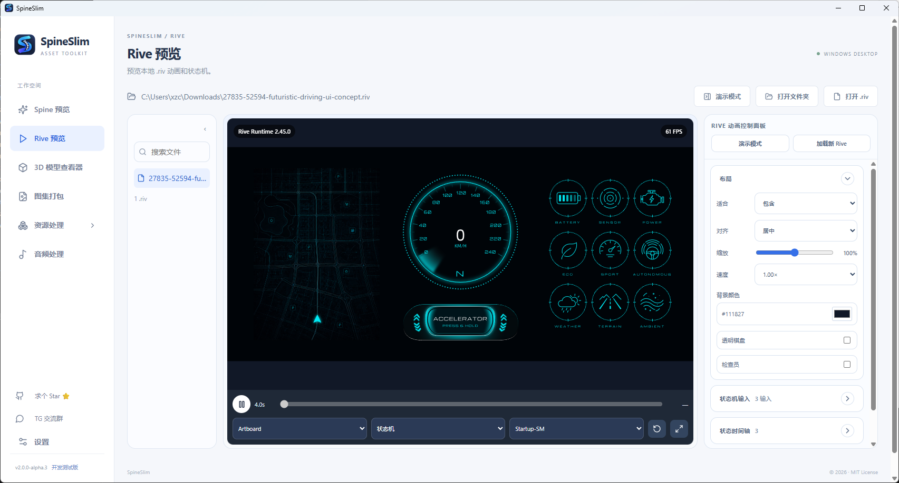

Open a local `.riv` file or scan a folder, switch artboards, animations and state machines, and test click or hold interactions. Adjust playback and layout, inspect traditional inputs, state timelines and event logs, and export a session JSON. The runtime is bundled and works offline; external assets are not downloaded automatically. [Features and limits →](docs/RIVE_VIEWER.md)

## 3D model viewer: GLB, GLTF, FBX, OBJ, STL

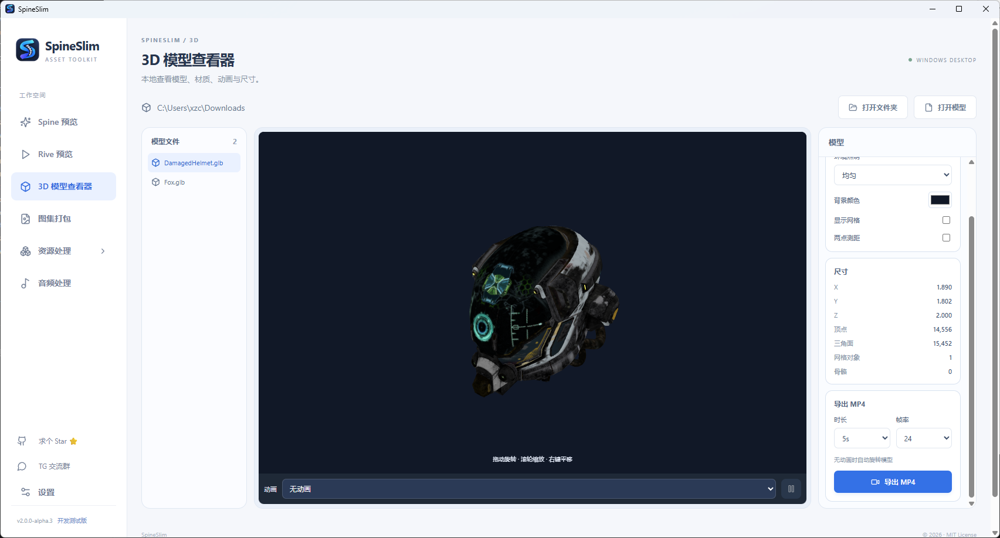

Open a GLB, GLTF, FBX, OBJ / MTL or STL file or folder. Inspect materials, animations, dimensions, meshes and bones; switch lighting, wireframe and normals; measure between two surface points. MP4 export uses FFmpeg. Keep external GLTF buffers (`.bin`), OBJ materials and textures inside the selected folder. Measurements use model units, which may not be metres. [Features and format limits →](docs/MODEL_VIEWER.md)

## Sprite sheet and texture atlas packer for game engines

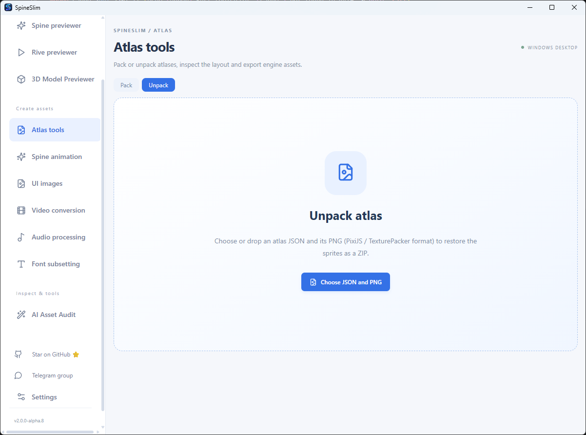

The standalone packer runs locally and **does not require TexturePacker**. Import PNG / JPG / WebP files or directories, append, search and remove images, inspect the layout and switch pages. Adjust dimensions, power-of-two or fixed sizing, scale, alpha trimming and threshold, padding and edge extrusion; packing updates automatically.

| Target | Export |
| --- | --- |
| PixiJS | PNG + spritesheet JSON with multipack references |
| Spine | PNG + multipage Atlas |
| Cocos Creator / cocos2d-x | PNG + plist format 3 |
| Godot 4 | PNG + AtlasTexture `.tres` resources |
| Unity | PNG + `.spineslim.json` + Editor importer |
| Phaser 3 | PNG + multiatlas JSON |

Save a ZIP, optionally including both PixiJS JSON and Spine Atlas. Unity mode keeps full canvases and disables trimming. Install the importer once under `Assets/Editor`, then use `Tools → SpineSlim → Import Atlas` to create Multiple Sprites. It does not generate a Unity `.spriteatlas` asset.

Rotation and duplicate-image merging are not implemented. Limits: 500 images, 32 Mi source pixels, 32 MiB per file, 16 output pages / 64 Mi output pixels, maximum dimension 8192. [Export formats and import instructions →](docs/ATLAS_PACKER.md)

## Game asset processing and texture optimization

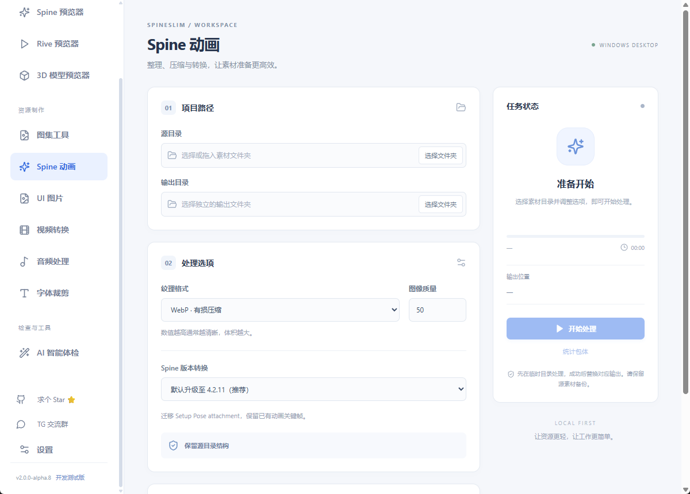

### Before and after: see the size reduction at a glance

**Background image example: JPG 2,249 KB → WebP 165 KB, about 92.7% smaller, saving approximately 2,084 KB.**

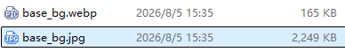

In the Spine example below, a PNG texture drops from **359 KB** to **74 KB** as WebP: about **79% smaller**, saving roughly **285 KB**. SpineSlim updates the Atlas texture reference; the `.skel` needs no conversion. Figures describe single textures and are calculated from the sizes shown in Windows Explorer; real compression ratios and visual quality vary with image content, quality settings and alpha data.

| Before: PNG | After: WebP |
| --- | --- |
| 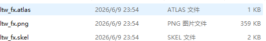 | 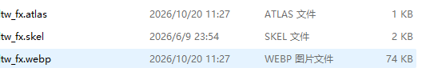 |

### Spine textures and version conversion

Recursively process Spine folders, preserve relative paths and update Atlas texture references. Spine and UI texture settings are saved independently.

| Format | Behavior |
| --- | --- |
| Original (default) | Preserve extensions; attempt lossless compression for PNGs |
| WebP | Adjustable quality and transparency |
| PNG | Lossless; keeps the existing PNG if compression makes it larger |
| JPG | Adjustable quality; transparency is flattened onto white |
| Basis | Exports `.basis`; requires support in your game runtime |

Optionally upgrade JSON to **Spine 4.2.11**, migrate setup-pose attachments and preserve existing animation keys. Preflight accepts 3.5 / 3.6 / 3.7 / 3.8 / 4.0 / 4.1 and recognizes 4.2 as already upgraded. An accepted version does not guarantee conversion of every asset. The upgrade uses an external converter.

Choose “Target version (advanced)” to enter a complete `x.y.z` version in the 3.5–3.8 or 4.0–4.2 range, keeping the source format or outputting JSON / SKEL. This mode handles both Spine JSON and SKEL and writes to a separate `program/spine-converted` folder; the source stays unchanged. Downgrades may alter newer curves, constraints and timelines, so verify in the target Spine runtime. A later run replaces existing `program/spine-converted` contents.

### UI images, fonts and video

- Classify UI assets into backgrounds, atlases and fonts, or enable “Process all images as backgrounds.”
- The UI atlas pipeline uses TexturePacker, unlike the standalone atlas packer. Background-only mode does not require it.
- Images whose names contain `guide` are skipped. A third underscore-separated segment of `pce` selects atlas packing; `pack` selects a background. Otherwise JPG / JPEG becomes a background, PNG smaller than 2048 × 1024 becomes a sprite, and larger PNG becomes a background.
- `winnum` assets use Pillow-based bitmap font generation, without BMFont. The pipeline also handles TTF / OTF files and JSON under `part`.
- Convert MOV / MP4 / M4V / WebM / MKV / AVI to WebM / VP9, with Opus audio when present. CRF ranges from 0–63; higher generally means smaller. Alpha requires a source and playback environment that support it.

### Output and tasks

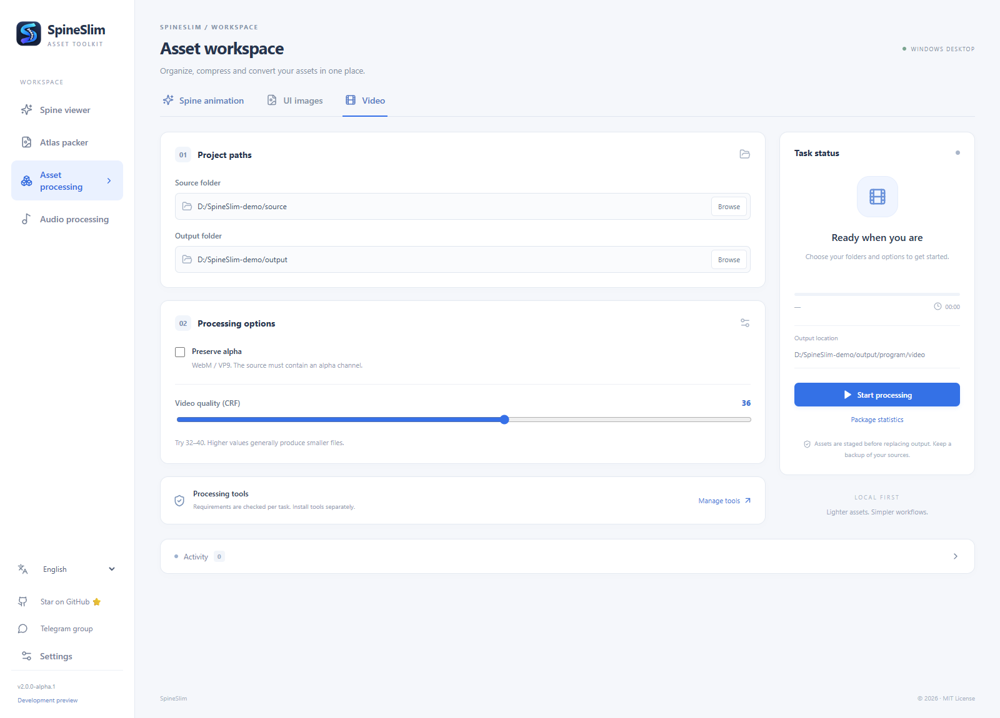

```text
output/program/
├─ spine/           Original Spine folder hierarchy
├─ bg/              UI backgrounds at original dimensions
├─ atlas/           UI atlases
├─ fonts/           Fonts
├─ part/            Classified JSON
└─ video/
   ├─ pc/           Original-size WebM
   └─ mobile/       Approximately half size, rounded to even dimensions
```

Current-file and stage progress, logs, size statistics and cancellation are available. Processing uses staging before committing results. **A successful commit replaces existing output in its scope:** Spine replaces `program/spine`; UI replaces everything under `program` except `spine`; video updates PC / Mobile WebM outputs. Use a dedicated output folder and review the confirmation dialog.

## Game audio processing: compression, merging and audio sprites

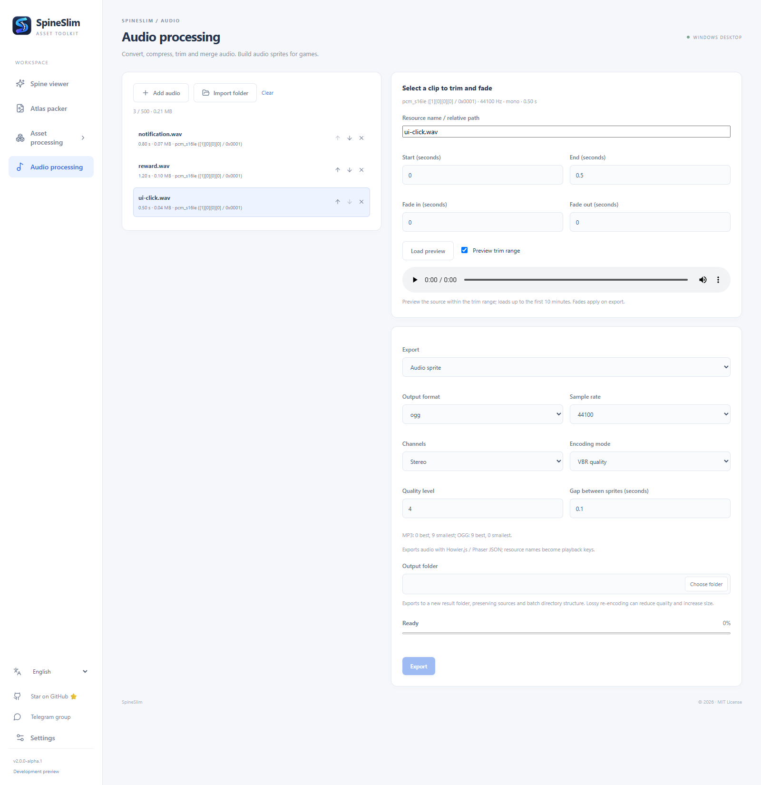

- Import files or folders, or drag and drop MP3, OGG, WAV, FLAC, M4A, AAC, OPUS, AIFF and WMA.
- Inspect duration, codec, sample rate, channels and size; preview source audio within an optional trim range.
- Set start / end times and fade-in / out per clip. Reorder with arrow buttons or drag and drop.
- Batch convert and compress to **MP3, OGG Vorbis or PCM 16-bit WAV**, with sample rate, mono / stereo, VBR quality or target bitrate.
- **Merge short clips** in order, even with mixed formats or sample rates: normalize to PCM, concatenate, then encode.
- **Audio sprites:** export one merged audio file with Howler.js / Phaser JSON, configurable gaps and named playback segments.
- Track progress and input / output sizes, cancel work and open the result folder.

Each export creates a unique `SpineSlim-audio-*` folder and preserves sources. Batch mode preserves the imported directory structure. Limits: 500 clips, two hours per source and total processing duration. Preview loads the first ten minutes; fades apply at export. All exports re-encode, so lossy processing may reduce quality and does not guarantee smaller files.

MP3 VBR: 0 is best quality, 9 smallest. OGG VBR: 9 is best quality, 0 smallest. For strict timing or gapless playback, use WAV and validate in your game runtime. [Audio workflow and game integration →](docs/AUDIO_PROCESSING.md)

## Font subsetting: trim TTF / OTF to the characters you use

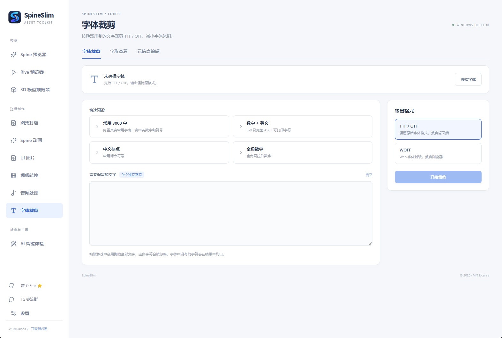

- Choose a TTF or OTF font, paste the text your game displays, or use a quick preset: common 3,000 Chinese characters, digits and English, Chinese punctuation, or full-width digits.
- Output keeps the original format, or can be WOFF for the web. The size change is shown after subsetting and the result is saved through a save dialog.
- The glyph view lists every glyph in the font, including unmapped ones, with search by character, `U+` code point or glyph name.
- Metadata editing changes family, style, version, copyright and other name fields, and exports a new file. The original font is not modified.
- Hinting is removed to reduce size. Small text may look different on some renderers, so verify in your target engine.

## External tools

| Feature | Dependency |
| --- | --- |
| Spine / Rive / 3D preview and standalone atlas packing | No external asset-processing executable; GIF / MP4 export additionally requires FFmpeg |
| GIF / MP4 export, audio processing, video conversion | [FFmpeg](https://ffmpeg.org/download.html); audio needs libmp3lame / libvorbis, MP4 needs libx264 |
| Standard image optimization and conversion | [ImageMagick](https://imagemagick.org/script/download.php) |
| Basis textures | [Basis Universal](https://github.com/BinomialLLC/basis_universal/releases) |
| UI atlases within Asset processing | [TexturePacker](https://www.codeandweb.com/texturepacker/download) |
| Spine JSON upgrades | SpineSkeletonDataConverter |

Discovery uses saved paths, application and `tools/<tool-key>/` folders, PATH and other supported locations. Open Settings at the bottom of the sidebar to detect tools or choose their paths. Keep portable tools' companion files; do not copy only the EXE.

The default Tauri package does not bundle these external tools. The full-package script is for local testing and does not establish redistribution rights. Check each release's contents and the [third-party notices](THIRD_PARTY.md).

## Build from source

Requires Windows x64, Node.js 20.19+ or 22.12+, Python 3.12+, stable Rust, MSVC C++ build tools and WebView2.

```powershell
git clone https://github.com/Alone9898/SpineSlim.git
cd SpineSlim
python -m venv .venv
.\.venv\Scripts\python.exe -m pip install -r requirements.txt pyinstaller
npm ci
.\.venv\Scripts\python.exe scripts/build_worker.py
npm run desktop
```

Rebuild the worker after editing Python code. `npm run dev` alone starts only the web development server, without full desktop capabilities. The Tauri app no longer starts through the legacy `python main.py` entry point.

```powershell
npm run build
cargo check --manifest-path src-tauri/Cargo.toml
.\.venv\Scripts\python.exe -m unittest discover -s tests -v

.\.venv\Scripts\python.exe scripts/build_worker.py
npm run package
```

The default NSIS installer is generated under `src-tauri/target/release/bundle/nsis/`. The main EXE alone is not enough: the Python worker and other packaged files are required. Validate installation, tool discovery and core workflows on a clean computer before releasing.

## FAQ

### How can I preview Spine SKEL animations on Windows?

Import the complete folder containing SKEL, Atlas and texture files into SpineSlim's Spine viewer. It loads Spine 3.8 / 4.0 / 4.1 / 4.2 and provides animation and skin controls without requiring the Spine editor. Previewing does not upgrade or rewrite source files.

### Can I pack sprite sheets without TexturePacker?

Yes. SpineSlim's standalone atlas packer packs PNG / JPG / WebP images locally without TexturePacker. Choose PixiJS spritesheet JSON, Phaser 3 multiatlas JSON, Cocos plist, Godot 4 AtlasTexture, Unity's included Editor importer, or Spine Atlas. The separate UI classification workflow in Asset processing still uses TexturePacker.

### Which atlas format should I choose for PixiJS, Phaser, Unity, Cocos and Godot?

PixiJS: spritesheet JSON. Phaser 3: multiatlas JSON. Cocos Creator / cocos2d-x: plist. Godot 4: AtlasTexture. Unity: the manifest with the Editor importer. Each export ships with PNG pages, and one engine's metadata cannot be used directly in another engine.

### How do I combine short sound effects for an HTML5 game?

Use audio sprite mode to merge clips and export timing metadata for Howler.js or Phaser, then play clips by name. Use Merge mode for continuous sequential playback, or Batch mode to keep separate files for Unity, Godot, Cocos and other workflows.

### How do I reduce the size of Spine textures and game backgrounds?

Use Asset processing to convert PNG / JPG textures to WebP (or optimized PNG / JPG / Basis). SpineSlim updates Atlas texture references automatically. See the [before and after examples](#before-and-after-see-the-size-reduction-at-a-glance); results depend on your images and quality settings.

### What is the difference between Spine preview, texture compression and version upgrade?

Preview only plays animations. Texture compression converts textures and updates Atlas references. Version conversion rewrites skeleton JSON / SKEL. Preview never upgrades source files, and being able to preview a version does not mean every asset of that version upgrades successfully.

### Does SpineSlim support macOS or Linux?

Not yet. Only Windows x64 is supported at present.

### Is SpineSlim free? Does it upload my files?

SpineSlim is free and MIT-licensed. Assets are processed locally. The only network feature is the optional AI audit chat, which sends a summary only after you press Send, using your own model account.

### Troubleshooting

| Problem | Answer |
| --- | --- |
| `Atlas PNG page missing` | A referenced texture is missing or has the wrong relative path; import the complete asset folder |
| Compatibility summary passes, task fails | The summary only covers upgrades; inspect subsequent texture / video errors |
| Does atlas packing require TexturePacker? | The standalone module does not; the UI classification atlas pipeline does |
| FFmpeg or another tool is missing | Install the complete tool on PATH and restart, or set its path in Settings |
| How do I play clips separately after merging? | Export an audio sprite and use the Howler.js / Phaser timing metadata |
| New modules missing after download | Check whether you downloaded a legacy 1.x build; 2.0 builds may be under Pre-release |
| Where is Settings? | Hidden in packaged builds by the current product configuration; shown in development |
| Why white JPG backgrounds / little PNG savings? | JPG has no transparency; already optimized PNGs may not shrink |

## Documentation

- [2.0.0-alpha.10 release notes](docs/RELEASE_NOTES_2.0.0-alpha.10.md): particle viewer and fix for Spine compression failing on existing compressed textures
- [2.0.0-alpha.9 release notes](docs/RELEASE_NOTES_2.0.0-alpha.9.md): font subsetting, glyph viewer, metadata editing and navigation changes
- [2.0.0-alpha.7 release notes](docs/RELEASE_NOTES_2.0.0-alpha.7.md): local asset audit, report export and optional AI chat
- [2.0.0-alpha.6 release notes](docs/RELEASE_NOTES_2.0.0-alpha.6.md): AI audit preview and anonymous statistics improvements
- [2.0.0-alpha.5 release notes](docs/RELEASE_NOTES_2.0.0-alpha.5.md): Spine version upgrade / downgrade and separate output
- [2.0.0-alpha.4 release notes](docs/RELEASE_NOTES_2.0.0-alpha.4.md): 3D model viewer and animation-name copying
- [2.0.0-alpha.3 release notes](docs/RELEASE_NOTES_2.0.0-alpha.3.md): Rive viewer, update check and Spine conversion improvements
- [2.0.0-alpha.2 fix log](docs/RELEASE_NOTES_2.0.0-alpha.2.md): Windows output commit and worker packaging fixes
- [Anonymous usage statistics](docs/TELEMETRY.md): event list, privacy scope and PostHog Cloud configuration
- [Third-party notices](THIRD_PARTY.md): Spine Runtime, FFmpeg, TexturePacker and other licenses
- [简体中文完整说明](README.zh-CN.md): the full Chinese guide

## Community and license

Visit the [official website](https://www.jyhzai.com/en/spineslim/) for product information. Report issues through [GitHub Issues](https://github.com/Alone9898/SpineSlim/issues) or [Telegram](https://t.me/+XlcsJcxyKZtlNGYy), including the app and Windows versions, module, options, logs and a minimal sample you have the right to share.

Project code uses the [MIT License](LICENSE). Spine runtimes, external tools and assets retain their own terms; see [THIRD_PARTY.md](THIRD_PARTY.md). SpineSlim is an independent third-party project and is not affiliated with Esoteric Software or Spine.

Some screenshots use self-made geometric shapes and synthesized audio; 3D / Rive screenshots were provided by users, and the rights to sample models and animations belong to their original authors.

**Keywords:** Spine viewer, Spine JSON SKEL preview, Spine version converter, Rive viewer, 3D model viewer, sprite sheet packer, texture atlas packer without TexturePacker, Unity sprite atlas, Cocos Creator plist, Godot AtlasTexture, PixiJS spritesheet, Phaser multiatlas, audio sprite generator, Howler.js, texture compression, WebP, font subsetting, game asset optimization, Windows.
