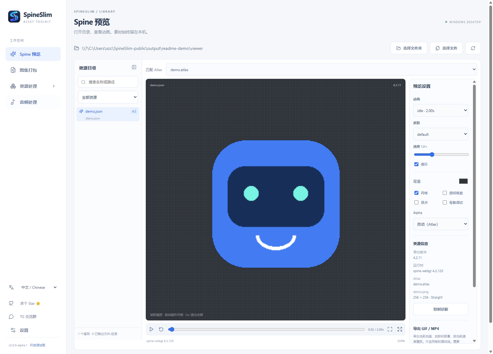
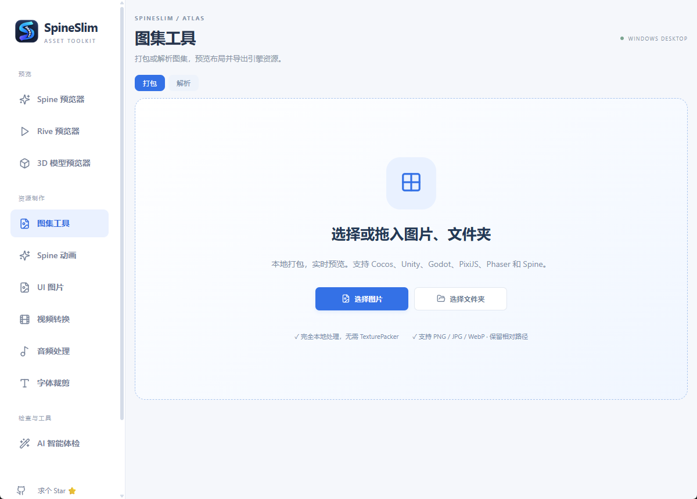
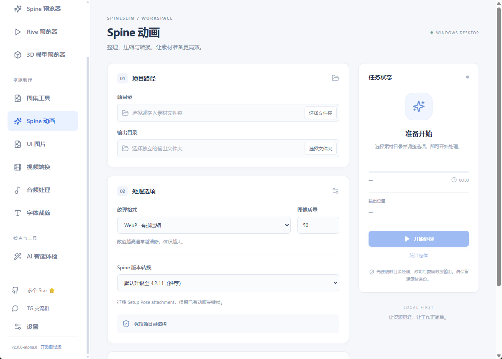
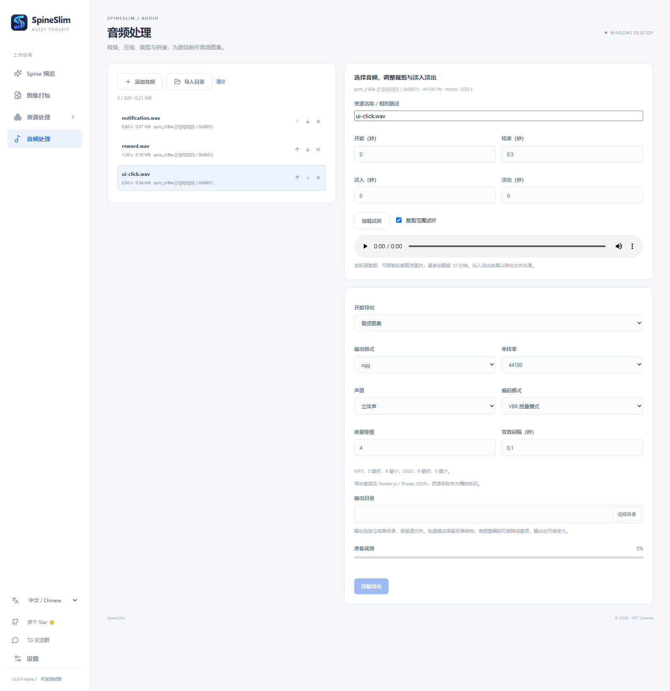

# SpineSlim — Spine Viewer & Game Asset Toolkit

**面向 Unity、Cocos、Godot、PixiJS 和 Phaser 游戏开发者的本地资源工具箱：Spine 动画预览、精灵图集打包、纹理压缩与音频处理。**

SpineSlim is a Windows desktop game asset toolkit for Unity, Cocos Creator, Godot, PixiJS and Phaser developers. Preview Spine JSON/SKEL animations, pack sprite sheets and texture atlases, optimize textures, and build audio sprites locally.

[下载 / Releases](https://github.com/Alone9898/SpineSlim/releases) · [中文使用说明](README.zh-CN.md) · [English](README.en-US.md) · [TG 交流群](https://t.me/+XlcsJcxyKZtlNGYy) · [反馈问题](https://github.com/Alone9898/SpineSlim/issues)

如果 SpineSlim 帮你节省了时间，欢迎点个 **[Star ⭐](https://github.com/Alone9898/SpineSlim)**。

## 现在可以做什么

适合独立游戏开发者、2D 游戏美术和技术美术整理项目素材，也适合 HTML5 / Web 游戏开发者生成精灵图集（sprite sheet / texture atlas）与音频图集（audio sprite）。各引擎的接入方式见下表；SpineSlim 是独立桌面工具。

| 模块 | 主要功能 |
| --- | --- |
| **Spine 预览** | 本地目录扫描，3.8 / 4.0 / 4.1 / 4.2 JSON 与 SKEL，动画与皮肤切换、缩放平移、全屏、GIF / MP4 导出 |
| **图集打包** | 自动排列、透明裁剪、边缘扩展、多页预览，导出 Cocos / Unity / Godot / PixiJS / Phaser / Spine 格式 |
| **资源处理** | Spine JSON 升级、纹理压缩、UI 分类处理、位图字体、WebM / VP9 视频转换 |
| **音频处理** | 批量转换压缩、试听、裁剪、淡入淡出、短音频合并、Howler.js / Phaser 音频图集 |

Tauri 2 + React + TypeScript + Python 后台。中文默认，支持 English；桌面使用无需另开浏览器，资源在本机处理。

本文对应 **2.0 开发线**，当前源码版本为 `2.0.0-alpha.1`。下载时请核对 Release 的版本与功能说明；旧版 1.x 不包含全部新模块。当前主要支持 Windows x64，尚未提供 macOS 安装包。

## Unity、Cocos、Godot、PixiJS 和 Phaser 怎么接入？

| 游戏引擎 / 框架 | 资源接入方式 |
| --- | --- |
| **Unity 2D** | 导出 PNG、切片清单和 Editor 脚本，导入为 Multiple Sprites；不是原生 `.spriteatlas` |
| **Cocos Creator / cocos2d-x** | 导出 PNG + plist 精灵图集，包含透明裁剪偏移 |
| **Godot 4** | 导出 PNG + AtlasTexture `.tres`，供 Sprite2D / TextureRect / SpriteFrames 使用 |
| **PixiJS（Pixi）** | 导出 spritesheet JSON 与 PNG，支持多页图集关联 |
| **Phaser 3** | 导出 multiatlas JSON；音频模块另提供 audio sprite JSON |
| **Spine / Howler.js** | 分别导出 Spine Atlas 和 Howler.js 音效时间配置 |

Unity / Godot / Cocos 导出已验证文件结构与坐标，实际编辑器导入仍需在目标项目测试。图片图集和音频图集是两种独立输出，具体格式见各模块说明。

## Spine 动画预览器：JSON / SKEL 与 GIF / MP4 导出

打开包含骨骼、Atlas 和贴图的目录，即可浏览资源并切换动画。支持播放、暂停、循环、速度、时间轴、网格、透明棋盘、Alpha 模式及 GIF / MP4 导出。

预览不要求安装 Spine 编辑器，也不改写骨骼文件。GIF / MP4 导出需要 FFmpeg；Spine Runtime 的使用与分发适用其自身许可。

## 精灵图集打包：Sprite Sheet / Texture Atlas Packer

拖入 PNG / JPG / WebP，自动预览打包布局。可调整尺寸、缩放、间距、边缘扩展、透明裁剪与多页设置，导出 PNG 和引擎元数据 ZIP。**独立图集模块无需 TexturePacker。**

支持 Cocos plist、PixiJS JSON、Spine Atlas、Godot 4 AtlasTexture、Unity 导入脚本和 Phaser 3 多页 JSON。[查看格式与导入说明 →](docs/ATLAS_PACKER.md)

## 资源处理

批量整理 Spine、UI 图片与视频。纹理可选择原格式、WebP、PNG、JPG 或 Basis，处理过程显示当前文件、阶段进度和日志。

保留 Spine 源目录层级，按需升级 JSON 至 4.2.11；UI 提供背景图、图集及位图字体处理；视频输出 WebM / VP9。外部工具按使用的功能准备。[完整流程与输出规则 →](README.zh-CN.md#资源处理)

## 游戏音频处理：音效压缩、合并与 Audio Sprite

把零散音效统一转换为 MP3 / OGG / WAV，或按顺序合成一个音频。选择音频图集，还会生成每段音效的播放时间，供 Howler.js / Phaser 按名称播放。

支持目录导入、排序、原音频试听、裁剪、淡入淡出、采样率与声道设置、VBR / 目标码率、进度与取消。每次导出写入独立结果目录，不覆盖源文件。[音频使用说明 →](docs/AUDIO_PROCESSING.md)

## 开发者常见问题

### 如何在 Windows 上预览 Spine SKEL 文件？

在 SpineSlim 的「Spine 预览」中导入包含 SKEL、Atlas 和贴图的完整目录。当前接入 Spine 3.8 / 4.0 / 4.1 / 4.2，可切换动画与皮肤；无需安装 Spine 编辑器。

### 有没有不依赖 TexturePacker 的游戏图集打包方式？

SpineSlim 的独立「图集打包」模块可将 PNG / JPG / WebP 打包为 PNG 图集，导出 Unity、Cocos、Godot、PixiJS、Phaser 和 Spine 对应元数据，无需 TexturePacker。资源处理中的 UI 自动分类图集流程仍使用 TexturePacker。

### 如何把多个短音效合并后在游戏中分别播放？

选择「音频处理 → 音频图集」，输出合并音频与 Howler.js / Phaser 时间配置，按片段名称播放。仅需要连续播放时选择「按顺序拼接」；Unity、Godot、Cocos 项目也可使用批量输出的独立音频文件。

## 下载与使用

1. 打开 [Releases](https://github.com/Alone9898/SpineSlim/releases)，选择所需的 Windows x64 版本；测试版本可能标记为 Pre-release。
2. 安装版运行安装程序；便携版完整解压后启动。以该 Release 提供的文件类型为准。
3. 选择模块并导入本地素材。预览与独立图集打包不需要外部处理工具；音频、视频及 GIF / MP4 导出需要 FFmpeg。

运行已打包程序无需自行安装 Python、Node.js 或 Rust。WebView2 和外部工具是否随包提供，以对应 Release 说明为准。

## 文档与许可

- [中文完整说明](README.zh-CN.md) / [English guide](README.en-US.md)：功能、依赖、源码运行、常见问题。
- [2.0.0-alpha.1 更新说明草稿](docs/RELEASE_NOTES_2.0.0-alpha.1.md)：可用于 GitHub Release 正文。
- [第三方组件说明](THIRD_PARTY.md)：Spine Runtime、FFmpeg、TexturePacker 等的许可说明。

项目自有代码采用 [MIT License](LICENSE)。第三方组件、外部工具和素材遵循各自许可。SpineSlim 是独立第三方项目，与 Spine 官方无关联。

截图使用自制几何图形和合成音频；开发版和正式打包版均可从侧栏底部打开设置。
