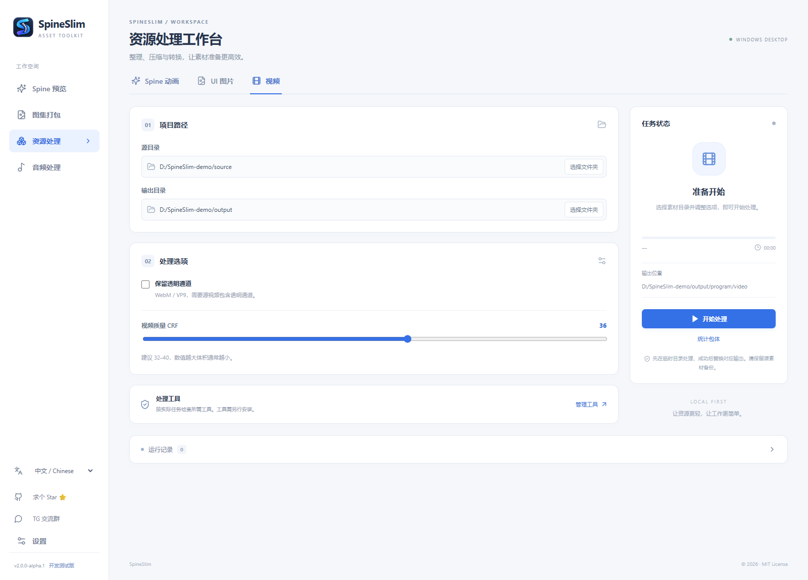
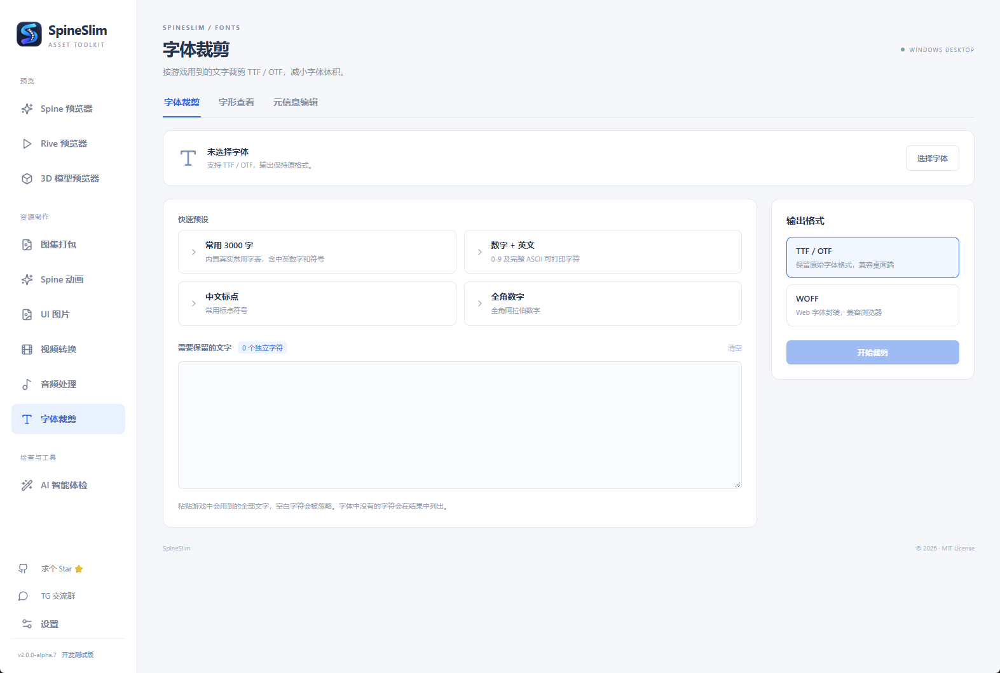

# SpineSlim · 游戏资源工具箱中文使用说明

**为 Unity、Cocos Creator、Godot、PixiJS（Pixi）和 Phaser 开发者提供 Spine / Rive 预览、3D 模型查看、精灵图集打包、纹理压缩和游戏音效处理。**

SpineSlim 是 Windows 本地游戏资源工具，面向独立游戏开发者、2D 游戏美术、技术美术和 HTML5 / Web 游戏团队。可用于查看 Spine JSON / SKEL 动画、制作 sprite sheet / texture atlas，以及为 Howler.js / Phaser 生成 audio sprite。各引擎的导出格式和限制见下文。

[产品官网](https://www.jyhzai.com/spineslim/) · [English Website](https://www.jyhzai.com/en/spineslim/) · [项目首页](README.md) · [English](README.en-US.md) · [下载 Releases](https://github.com/Alone9898/SpineSlim/releases) · [TG 交流群](https://t.me/+XlcsJcxyKZtlNGYy) · [Star ⭐](https://github.com/Alone9898/SpineSlim)

当前文档对应 Tauri 2.0 开发线，源码版本 `2.0.0-alpha.8`。访问 [SpineSlim 产品官网](https://www.jyhzai.com/spineslim/)可查看产品介绍，发行包功能以对应 Release 为准。旧版 1.x 不包含全部新功能。主要支持 Windows x64；macOS 安装包尚未提供。

## 快速开始

1. 访问[产品官网](https://www.jyhzai.com/spineslim/)了解功能，或从 [Releases](https://github.com/Alone9898/SpineSlim/releases) 选择 Windows x64 版本，注意区分正式版和 Pre-release。
2. 按发布附件类型安装或完整解压，启动 SpineSlim。已打包程序无需安装 Python、Node.js 或 Rust。
3. 左侧选择 **Spine 预览器 / Rive 预览器 / 3D 模型预览器**（预览），或 **图集打包 / Spine 动画 / UI 图片 / 视频转换 / 音频处理 / 字体裁剪**（资源制作），通过按钮或拖拽导入素材。
4. 需要编码、压缩时，按下文准备相应工具。资源处理的源目录与目标目录不能相同或互相嵌套。

默认中文，可在“设置”中切换 English 并检查软件更新。直接在桌面窗口内使用，无需额外打开浏览器；资源在本机处理。系统需要 WebView2，安装包是否包含离线组件以 Release 为准。

Rive 预览器可离线打开本地 `.riv`、切换画板和状态机，并测试传统输入控件；3D 模型预览器可本地查看模型、材质和动画。二者都支持文件或文件夹拖拽导入。详情见 [Rive 预览说明](docs/RIVE_VIEWER.md)与 [3D 模型查看器说明](docs/MODEL_VIEWER.md)。

## AI 智能体检：本地规则与可选 AI 对话

选择或拖入游戏资源目录，本地检查精确重复、缺失依赖、图片尺寸、透明边距、文件体积、命名和格式问题。体检结果按严重程度筛选，支持搜索、定位问题文件、查看规则覆盖范围，并导出 JSON / HTML 报告。扫描不会修改原文件；未覆盖的内容不会被当作通过。

扫描完成后可选择自己的 DeepSeek、OpenAI 等兼容模型或 Anthropic / Gemini 服务，手动发送体检摘要并提问。默认摘要只有统计数量与问题类型；勾选后才附带有限的相对文件名和证据。只有点击发送才联网，模型费用由用户自己的服务账号承担；AI 建议需核对，软件不会自动删除素材。


## Spine 动画预览器：JSON / SKEL


- 扫描目录，浏览、搜索骨骼，匹配 Atlas 与贴图。
- 加载 **3.8 / 4.0 / 4.1 / 4.2** 的 JSON / SKEL；贴图支持 PNG / JPG / WebP。
- 动画、皮肤切换，播放 / 暂停 / 循环、速度调节和时间轴定位；选中动画后可反复复制名称，直接用于游戏代码。
- 缩放、平移、适应画布、全屏、网格、原点、透明棋盘、背景色与骨骼调试。
- 查看版本、运行时、纹理信息，切换 Alpha 模式、复制诊断。
- 将当前动画、皮肤、取景和速度导出为 **GIF / MP4**，需要 FFmpeg。单次最长 30 秒；GIF 可选透明背景，MP4 使用背景色，不导出网格和调试线。

预览无需安装 Spine 编辑器，不改写源骨骼。**预览支持版本与 JSON 升级支持版本不同**；3.5–3.7、4.3 和 Basis/KTX 贴图目前不在预览范围内。特殊素材仍需实测。

## Rive 预览器：动画与状态机


打开单个 `.riv` 或扫描目录，切换画板、动画、状态机，测试点击和长按交互。可调播放速度、画布布局与背景，查看传统状态机输入、状态时间轴和事件日志，并将会话导出为 JSON。运行时随程序提供；外部素材不会自动联网下载。[详细说明与限制](docs/RIVE_VIEWER.md)

## 3D 模型预览器


支持 GLB、GLTF、FBX、OBJ / MTL 和 STL，选择单个文件或目录后可切换模型。可查看材质、动画、尺寸和网格，切换照明 / 线框 / 法线模式，进行两点测距；MP4 导出使用 FFmpeg。GLTF 的 `.bin`、OBJ 的 MTL 及贴图需位于所选目录内。测距使用模型单位，不保证是真实米数。[详细说明与格式限制](docs/MODEL_VIEWER.md)

## 精灵图集打包：Unity / Cocos / Godot / PixiJS / Phaser


独立图集模块在本地打包，**无需 TexturePacker**。支持 PNG / JPG / WebP 文件和目录导入、追加、搜索、移除、多页切换。调整尺寸、2 的幂、固定尺寸、缩放、透明裁剪、透明度阈值、间距和边缘扩展后自动重新打包。

| 目标 | 导出内容 |
| --- | --- |
| PixiJS | PNG + spritesheet JSON，包含多页关联 |
| Spine | PNG + 多页 Atlas |
| Cocos Creator / cocos2d-x | PNG + plist format 3 |
| Godot 4 | PNG + AtlasTexture `.tres` |
| Unity | PNG + `.spineslim.json` + Editor 导入脚本 |
| Phaser 3 | PNG + multiatlas JSON |

导出为 ZIP，可同时生成 PixiJS JSON 与 Spine Atlas。Unity 模式保留完整画布并关闭透明裁剪；将导入脚本放入 `Assets/Editor` 一次，通过 `Tools → SpineSlim → Import Atlas` 生成 Multiple Sprites，不生成 `.spriteatlas`。

目前不做旋转打包和重复图片合并。最多 500 张、源图总计 32 Mi 像素、单文件 32 MiB、输出最多 16 页 / 64 Mi 像素、单边最大 8192。新格式已验证文件结构与坐标；Unity / Godot / Cocos 的实际编辑器导入仍需在目标项目验证。

[图集格式与导入说明](docs/ATLAS_PACKER.md)

## 资源处理


### 处理前后对比：一眼看出包体变化

**背景图案例：原 JPG 2,249 KB → WebP 165 KB，体积减少约 92.7%，节省约 2,084 KB。** 下图展示原图 `base_bg.jpg` 与输出 `base_bg.webp` 的文件大小：


下面是用户提供的同一组 Spine 资源截图：PNG 贴图从 **359 KB** 降到 WebP **74 KB**，减少约 **79%**，单张节省约 **285 KB**。转换时同步更新 Atlas 的贴图引用，`.skel` 无需转换，适合 Unity、Cocos、Godot、PixiJS 和 Phaser 项目的纹理包体优化。以上为单张贴图的文件大小对比，按资源管理器显示值计算；实际压缩比例和画质取决于图片内容、质量设置和透明通道。

| 处理前：PNG | 处理后：WebP |
| --- | --- |
|  |  |

### Spine 与纹理

递归处理 Spine 目录、保留相对层级，自动更新 Atlas 纹理引用。Spine 与 UI 的纹理格式独立保存：

| 格式 | 行为 |
| --- | --- |
| 原格式（默认） | 保留扩展名；处理流程中的 PNG 尝试无损压缩 |
| WebP | 可调质量，支持透明度 |
| PNG | 无损压缩；已有 PNG 压缩后更大则保留原文件 |
| JPG | 可调质量，透明部分合成为白底 |
| Basis | 输出 `.basis`，需要游戏运行端提供对应支持 |

可选将 JSON 升级至 **Spine 4.2.11**，迁移 Setup Pose attachment 并保留已有动画关键帧。预检接受 3.5 / 3.6 / 3.7 / 3.8 / 4.0 / 4.1，4.2 识别为已升级。版本在范围内不保证所有素材均可成功转换；转换依赖外部工具，需检查结果。该流程不升级 `.skel`。

版本转换默认选择 **升级至 4.2.11**。在「指定目标版本（高级）」中，可输入 3.5–3.8 或 4.0–4.2 范围内的完整 `x.y.z` 版本号，并选择保留原格式、JSON 或 SKEL；该模式可处理 Spine JSON 和 SKEL，结果写入独立的 `program/spine-converted`，源目录不变。Atlas 与贴图按原处理选项复制或压缩，不参与骨骼版本转换。降级可能改变高版本曲线、约束和时间线，请在目标 Spine 运行时逐项检查。再次处理会替换已有的 `program/spine-converted` 内容。

### UI 图片、字体与视频

- UI 可分类生成背景、图集、字体，也可选择「全部图片按背景图处理」。
- 普通 UI 图集流程使用 TexturePacker，与独立「图集打包」模块不同；全部背景图模式不要求 TexturePacker。
- 文件名含 `guide` 的图片跳过；按 `_` 分隔后第三段为 `pce` 的进入图集，为 `pack` 的作背景。无标记时 JPG/JPEG 作背景；宽小于 2048 且高小于 1024 的 PNG 作碎图，其余作背景。
- `winnum` 开头的资源走艺术字流程，使用 Pillow 生成位图字体，无需 BMFont；还可整理 TTF / OTF 和 `part` 目录中的 JSON。
- MOV / MP4 / M4V / WebM / MKV / AVI 转为 WebM / VP9，有音轨时编码为 Opus。CRF 为 0–63，越大通常越小；保留透明度要求源视频和运行端支持 Alpha。

### 输出与任务



```text
目标目录/program/
├─ spine/           保留 Spine 源目录层级
├─ bg/              UI 背景，保留原尺寸
├─ atlas/           UI 图集
├─ fonts/           字体
├─ part/            分类后的 JSON
└─ video/
   ├─ pc/           WebM，原尺寸
   └─ mobile/       WebM，约一半宽高，调整为偶数
```

显示当前文件、阶段进度、日志与包体统计，支持取消。先在临时目录处理，再提交结果；**成功提交会替换对应旧输出**：Spine 替换 `program/spine`；UI 替换 `program` 中除 `spine` 外的内容；视频更新 PC/Mobile WebM。请选择独立目标目录，留意确认对话框的范围。

## 游戏音频处理：压缩、短音效合并与音频图集


- 文件 / 目录导入与拖放，支持 MP3、OGG、WAV、FLAC、M4A、AAC、OPUS、AIFF、WMA。
- 查看时长、格式、采样率、声道、体积，试听原音频或裁剪范围。
- 为每段设置起止时间、淡入和淡出；上下箭头或拖动调整顺序。
- 批量转换 / 压缩为 **MP3、OGG Vorbis、PCM 16-bit WAV**，配置采样率、单 / 双声道、VBR 质量或目标码率。
- **拼接短音频**：不同格式、采样率也可合并，先统一 PCM 再按顺序拼接编码。
- **音频图集**：输出合并音频及 Howler.js / Phaser JSON，可设置片段间隔，按名称播放某段。
- 显示进度、输入 / 输出大小，可取消任务、打开结果目录。

每次导出生成唯一的 `SpineSlim-audio-*` 子目录，保留源文件；批量模式保留导入目录层级。最多 500 个文件，单文件及总处理时长不超过 2 小时。试听加载前 10 分钟，淡入淡出在导出时应用。所有导出会重新编码，有损压缩可能降低音质，也不保证文件更小。

MP3 VBR：0 质量最好、9 最小；OGG VBR：9 质量最好、0 最小。严格无缝或精确定位场景建议输出 WAV，并在游戏运行端验证。

[音频说明与游戏接入](docs/AUDIO_PROCESSING.md)

## 字体裁剪：按字符集精简 TTF / OTF



- 选择 TTF 或 OTF 字体，粘贴游戏中会用到的文字，或使用快速预设：常用 3000 字、数字 + 英文、中文标点、全角数字。
- 输出保持原格式，也可选择 WOFF（Web 字体封装）。裁剪完成后显示体积变化，结果通过保存对话框下载。
- 字形查看：列出字体中的全部字形（包括未映射的字形），支持按字符、`U+` 码位或字形名搜索。
- 元信息编辑：修改字体家族、样式、版本、版权等字段，导出为新文件，原字体不会被改动。
- 裁剪时会去掉 hinting 以减小体积；小字号在部分渲染环境下可能不如原字体清晰，请在目标引擎中验证。

## 外部工具

| 功能 | 依赖 |
| --- | --- |
| Spine / Rive / 3D 预览、独立图集打包 | 无需外部资源处理程序；GIF / MP4 导出另需 FFmpeg |
| GIF / MP4 导出、音频处理、视频转换 | [FFmpeg](https://ffmpeg.org/download.html)；音频需 libmp3lame / libvorbis，MP4 需 libx264 |
| 普通图片压缩与转换 | [ImageMagick](https://imagemagick.org/script/download.php) |
| Basis 纹理 | [Basis Universal](https://github.com/BinomialLLC/basis_universal/releases) |
| 资源处理中的 UI 图集 | [TexturePacker](https://www.codeandweb.com/texturepacker/download) |
| JSON 升级 | SpineSkeletonDataConverter |

查找已保存路径、应用目录及 `tools/<工具键>/`、系统 PATH 等位置。开发版和正式版均可从侧栏底部打开设置，检测工具或手动指定路径。便携工具应保留配套文件，不能一律只复制 EXE。

默认 Tauri 构建不捆绑这些外部工具。完整包脚本用于本地测试，不代表可直接公开再分发；发布附件是否带工具及其许可条件以 Release 为准，详见 [第三方说明](THIRD_PARTY.md)。

## 源码运行与打包

准备 Windows x64、Node.js 20.19+ 或 22.12+、Python 3.12+、Rust stable、MSVC C++ 构建工具及 WebView2。

```powershell
git clone https://github.com/Alone9898/SpineSlim.git
cd SpineSlim
python -m venv .venv
.\.venv\Scripts\python.exe -m pip install -r requirements.txt pyinstaller
npm ci
.\.venv\Scripts\python.exe scripts/build_worker.py
npm run desktop
```

修改 Python 后台后需重建 worker。仅运行 `npm run dev` 是网页开发服务，不具备完整桌面能力；当前 Tauri 入口不是旧版的 `python main.py`。

```powershell
npm run build
cargo check --manifest-path src-tauri/Cargo.toml
.\.venv\Scripts\python.exe -m unittest discover -s tests -v

.\.venv\Scripts\python.exe scripts/build_worker.py
npm run package
```

默认 NSIS 安装包位于 `src-tauri/target/release/bundle/nsis/`。只复制主 EXE 不能代替完整安装包，Python worker 等文件也必须存在。发布前应在没有开发环境的电脑验证安装、工具发现与核心流程。

## 常见问题

### PixiJS、Phaser、Unity、Cocos 和 Godot 应该选哪个图集格式？

PixiJS 选择 spritesheet JSON；Phaser 3 选择 multiatlas JSON；Cocos Creator / cocos2d-x 选择 plist；Godot 4 选择 AtlasTexture；Unity 选择带 Editor 导入脚本的清单。上述格式均附带 PNG，不能直接把一种引擎的元数据当作另一种引擎的资源使用。

### Spine 预览、纹理压缩与 Spine 版本升级有什么区别？

预览用于查看动画；纹理压缩处理贴图并更新 Atlas 引用；版本升级转换骨骼 JSON。预览不会自动升级源文件，能预览某个版本也不代表其所有素材都能成功升级。

### 如何减少 HTML5 游戏中的音效文件数量？

用音频图集把多个短音效合为一个文件，再通过 Howler.js 或 Phaser 的时间配置播放指定片段。若需要每个音效独立管理，使用批量转换模式保留分文件输出。

| 问题 | 说明 |
| --- | --- |
| `Atlas PNG page missing` | Atlas 引用的纹理缺失或路径不匹配；导入完整素材目录 |
| 兼容汇总成功，但整体失败 | 汇总只代表升级阶段，请查看后续纹理或视频错误 |
| 独立图集也要 TexturePacker？ | 不需要；资源处理中的 UI 自动分类图集流程需要 |
| 找不到 FFmpeg 等工具 | 确认完整安装并加入 PATH，重启应用；开发版可指定路径 |
| 合并后如何分别播放音效？ | 用音频图集模式读取 Howler.js / Phaser 时间元数据 |
| 下载后没有新模块 | 检查是否仍为旧版 1.x；2.0 测试包可能位于 Pre-release |
| 为什么没有设置？ | 打包版按当前产品设定隐藏，开发环境显示 |
| JPG 有白底 / PNG 没缩小 | JPG 不支持透明度，已优化的 PNG 不保证继续缩小 |

## 反馈与许可

访问 [SpineSlim 产品官网](https://www.jyhzai.com/spineslim/)获取产品信息。欢迎到 [Issues](https://github.com/Alone9898/SpineSlim/issues) 或 [TG 群聊](https://t.me/+XlcsJcxyKZtlNGYy) 反馈，附版本、Windows 版本、模块、参数、日志和有权分享的最小复现素材。喜欢可以点个 [Star ⭐](https://github.com/Alone9898/SpineSlim)。

自有代码采用 [MIT](LICENSE)。Spine Runtime、外部工具和素材适用各自许可，参阅 [THIRD_PARTY.md](THIRD_PARTY.md)。本项目与 Spine 官方无关联。截图使用自制示例，开发版设置入口与正式版不同。
